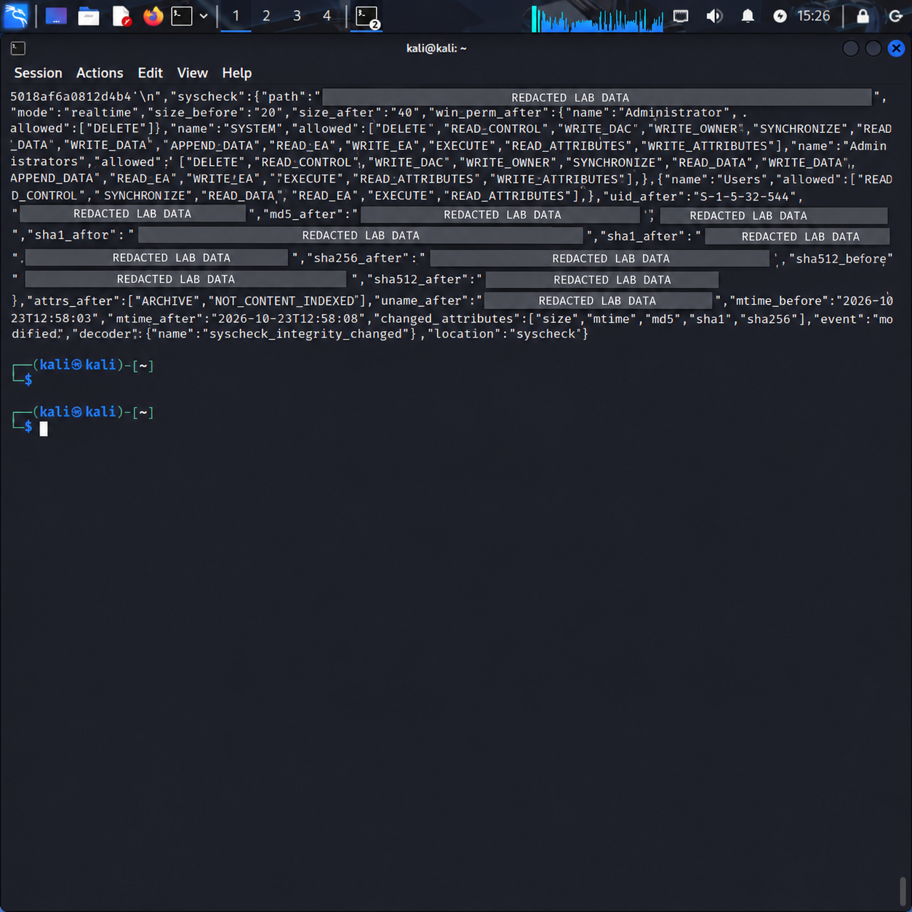
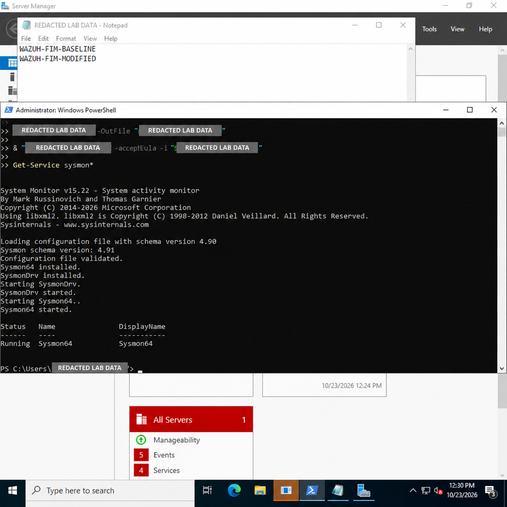

# Threat Hunting & Detection Lab — Wazuh

[](https://github.com/raphaelguterres/threat-hunting-detection-lab/actions/workflows/validate-lab.yml)

Laboratório prático de **monitoramento, engenharia de detecção e investigação** com Wazuh. O ambiente usa uma VM Kali Linux como servidor Wazuh em Docker, um agente Linux e um Windows Server 2022 em rede privada isolada.

> Todos os eventos deste projeto são simulações inofensivas. Não há exploração, malware ou tentativa de acesso a sistemas de terceiros.

## Projeto principal: Segurança Defensiva

Este é o projeto principal deste repositório para demonstrar competências em **Security Operations (SOC)**, threat hunting, engenharia de detecção e resposta orientada por evidências. Ele conecta telemetria real de endpoints Windows e Linux ao Wazuh, mapeia comportamentos ao MITRE ATT&CK e documenta o processo analítico — da coleta à decisão de triagem.

O foco não é gerar alertas em massa: é provar que cada alerta pode ser investigado com contexto, hipótese, evidência, decisão e próximos passos reproduzíveis.

## O que este laboratório demonstra

- Arquitetura manager + agentes Linux/Windows reais;
- coleta de logs e File Integrity Monitoring (FIM);
- criação de regras locais no Wazuh;
- priorização por severidade e investigação no dashboard;
- registro de evidências e recomendações de contenção.

## Estado atual

- Wazuh Manager, Indexer e Dashboard operacionais em Docker;
- agente Linux ativo, com telemetria nativa de autenticação, auditoria e FIM validada;
- agente Windows Server ativo, com coleta de Event Channels configurada;
- FIM ponta a ponta validado no Windows, incluindo hashes antes/depois;
- Sysmon instalado no Windows; ingestão dos IDs 1, 3 e 11 validada no Wazuh;
- cinco estudos de caso com linhas do tempo e controles negativos documentados;
- playbooks de autenticação, PowerShell, FIM e rede com aprovação humana e rollback;
- rede host-only isolada para gerenciamento das VMs, sem port forwarding público;
- evidências e limitações documentadas, sem apresentar simulações como incidentes reais.

Veja o [inventário](docs/inventory.md), a [arquitetura](docs/architecture.md), a [matriz de telemetria](docs/telemetry-matrix.md), o [catálogo de detecções](docs/detection-catalog.md), a [cobertura MITRE](docs/mitre-coverage.md), a [triagem de T1078/T1021](docs/mitre-triage-t1078-t1021.md), os [estudos de caso](docs/case-study-timelines.md), os [playbooks](playbooks/), a [checklist de publicação](docs/publication-checklist.md) e a [saúde operacional](docs/operational-health.md).

## Arquitetura

```text
Internet / rede de testes
          |
  +----------------------+       +------------------------+
  | VM Wazuh             |<------| Ubuntu endpoint        |
  | manager + indexer +  | agent | logs, FIM, auditoria   |
  | dashboard            |       +------------------------+
  +----------------------+       +------------------------+
             ^                   | Windows endpoint       |
             |                   | agent + Event Channel  |
             +-------------------+ eventos de autenticação |
                                 +------------------------+
```

O ambiente implantado inclui os dois endpoints. Endereços, nomes de host e demais dados que possam identificar o ambiente não devem ser expostos em publicações externas.

## Roteiro de implantação

1. Instale o Wazuh manager/dashboard e registre ao menos um agente conforme a documentação oficial: https://documentation.wazuh.com/
2. No **manager**, copie `config/local_rules.xml` para `/var/ossec/etc/rules/local_rules.xml` e reinicie o serviço:

   ```bash
   sudo systemctl restart wazuh-manager
   ```

3. No agente Linux, crie os diretórios e copie o trecho de `config/ossec-agent-linux.xml` para o seu `/var/ossec/etc/ossec.conf` (dentro de `<ossec_config>`).
4. Reinicie o agente:

   ```bash
   sudo systemctl restart wazuh-agent
   ```

5. Execute `scripts/simular_eventos_linux.sh` como administrador no endpoint Linux.
6. No Dashboard, filtre por `rule.groups: lab` ou pelos IDs `100100` a `100103`.
7. Siga e preencha [docs/registro-de-investigacao.md](docs/registro-de-investigacao.md). O roteiro de fala está em [docs/roteiro-de-apresentacao.md](docs/roteiro-de-apresentacao.md).

Para validações reproduzíveis, use os roteiros de [Sysmon no Windows](tests/windows-sysmon-validation.md), [FIM Linux](tests/linux-fim-validation.md) e o [checklist de qualidade de detecção](tests/detection-quality-gate.md).

## Cenários demonstrados

| Cenário | Evidência coletada | Alerta | Valor demonstrado |
|---|---|---:|---|
| Autenticação | SSH nativo no Kali | 5710 / nível 5 | separar tentativa isolada de brute force |
| Alteração de conta | Auditd no Kali | 100104 / nível 8 | correlacionar mudança e aprovação |
| PowerShell benigno | Sysmon ID 1 no Windows | 92027 / nível 4 | analisar comando e processo-pai |
| Integridade de arquivo | FIM nativo no Kali | 554 e 550 | preservar hashes antes/depois |
| Conexão privada autorizada | Sysmon ID 3 no Windows | 100105 / nível 3 | validar processo, porta e destino aprovado |

## Evidências para portfólio

O repositório não versiona capturas brutas. Antes de publicar, selecione capturas redigidas conforme a [checklist de publicação](docs/publication-checklist.md): agente ativo, um alerta Sysmon, uma alteração FIM com hashes e uma linha do tempo concluída.

| Evidência redigida | Finalidade |
| --- | --- |
|  | Demonstrar que o fluxo FIM chegou ao ambiente de monitoramento sem publicar hashes, usuários ou caminhos completos. |
|  | Demonstrar a instalação e o serviço Sysmon ativo no endpoint Windows isolado. |

## Critério de sucesso

O laboratório está pronto para apresentação quando os quatro alertas de regra local aparecem no dashboard, o FIM registra a mudança de `configuracao.conf` e você consegue responder: **o que ocorreu, em qual ativo, qual a criticidade, que evidência sustenta a conclusão e qual ação é recomendada**.

## Estrutura

```text
config/       Configuração do agente e regras do manager
scripts/      Simuladores controlados de eventos
docs/         Arquitetura, inventário, telemetria, detecções e playbooks
cases/        Estudos de caso e linhas do tempo
playbooks/    Guias de triagem e resposta com aprovação humana
evidencias/  Capturas e validações do ambiente
```

## Segurança

Todos os testes ocorrem exclusivamente nas VMs próprias e isoladas. Os simuladores não fazem exploração, não usam malware nem tentam acessar sistemas de terceiros. Qualquer contenção permanece em modo de observação ou exige aprovação humana.
