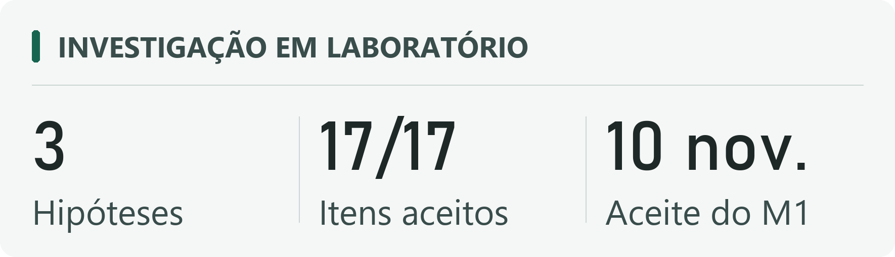

# Threat Hunting & Detection Lab

**Threat hunting com Wazuh, Sysmon e FIM em endpoints Windows e Linux.**

O laboratório acompanha a telemetria do endpoint até o SIEM. Cada investigação começa com uma hipótese e usa eventos de controle para testar se a mesma correlação apareceria em outra sessão, arquivo ou janela de tempo.

<picture>
  <source media="(prefers-color-scheme: dark)" srcset="docs/img/resumo-escuro.png">
  
</picture>

[Guia do laboratório](docs/guia-do-laboratorio.md) · [Revisão das três hipóteses](https://github.com/raphaelguterres/threat-hunting-detection-lab/blob/59eeef6/docs/m1-final-review-20261110.md) · [Roadmap](ROADMAP.md)

## Três investigações

- **H01 · PowerShell e tarefa agendada.** O mesmo usuário executou o PowerShell e criou uma tarefa desabilitada no mesmo ativo. O evento anterior ficou fora da correlação.
- **H02 · Conta criada e logon privilegiado.** Windows e Wazuh registraram a mesma identidade. O Logon ID distinguiu as sessões corretas dos cruzamentos de controle.
- **H03 · Alteração e execução de arquivo.** FIM e Sysmon registraram a alteração e a execução do mesmo binário benigno. O controle com outro arquivo ficou fora do resultado.

O proprietário aceitou **17/17 itens** do M1 em 10/11/2026 para o laboratório individual. O relatório registra a remoção da conta temporária de H02 como pendente de confirmação e mantém o guia para revisão independente. O painel de progresso registra os checkpoints anteriores, incluindo o teste FIM ponta a ponta. [Aceite do M1](https://github.com/raphaelguterres/threat-hunting-detection-lab/blob/59eeef6/docs/m1-final-review-20261110.md) · [Checkpoints](docs/roadmap-progress.md) · [Guia de revisão](docs/m1-pr-review-guide.md)

## Da coleta à triagem

Sysmon, Windows Event Channels, logs Linux, Auditd e FIM fornecem o contexto para investigar autenticação, alterações de conta, execução de processos, integridade de arquivos e conexões. Os agentes enviam eventos ao Wazuh Manager. O Indexer armazena os alertas e o Discover permite conferi-los. Os playbooks registram decisão, aprovação humana e rollback. [Arquitetura](docs/architecture.md) · [Casos e linhas do tempo](docs/case-study-timelines.md) · [Playbooks](playbooks/)

<details>
<summary>Ver as capturas sanitizadas</summary>

- [Integridade de arquivo monitorada no Kali](screenshots/redacted/kali-fim-redacted.png)
- [Telemetria do Sysmon no Windows](screenshots/redacted/windows-sysmon-redacted.png)
- [Critérios de sanitização](screenshots/README.md)

</details>

## Validação local

```powershell
python -m unittest discover -s tests
```

Os testes locais usam fixtures para verificar correlação, configuração e critérios de evidência. No Windows, execute `.\scripts\validate_lab_config.ps1` para verificar a configuração do repositório. Os exercícios com eventos reais usam VMs próprias em rede privada. [Integração contínua](https://github.com/raphaelguterres/threat-hunting-detection-lab/actions/workflows/validate-lab.yml)

[Catálogo de detecções](docs/detection-catalog.md) · [Telemetria](docs/telemetry-matrix.md) · [MITRE ATT&CK](docs/mitre-coverage.md) · [Publicação segura](docs/publication-checklist.md)
