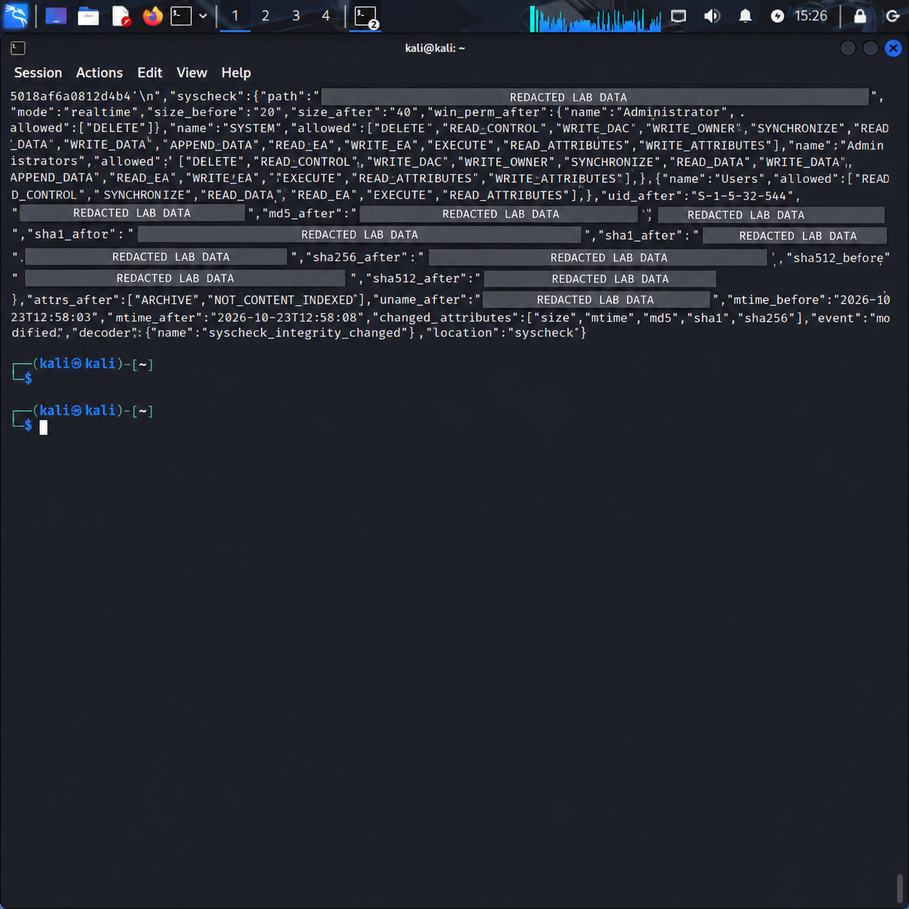
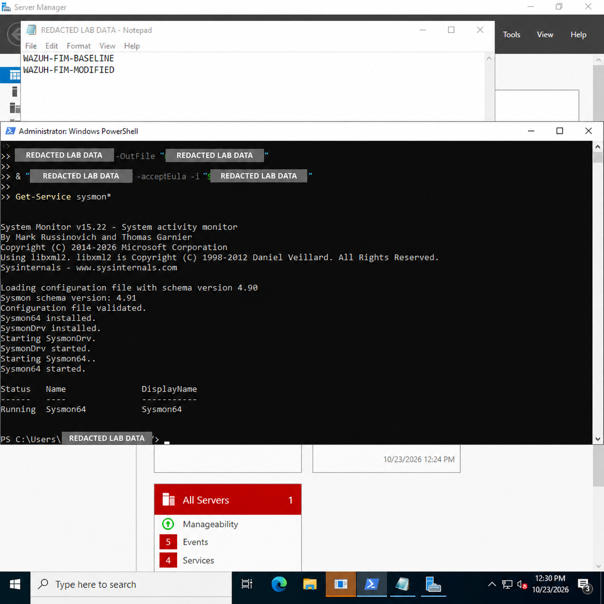

# Threat Hunting & Detection Lab — Wazuh

**M1 13/17 — 76,5% (05/11/2026):** [inventário `002/004/005` revisado, risco de sobreposição Security documentado e FIM Windows `004` validado com 3 alertas reais](docs/m1-inventory-security-overlap-fim004-closure-20261105.md). Faltam quatro entregas M1. A **duplicidade efetiva não foi demonstrada nem corrigida**: o risco de coletores sobrepostos e a auditoria `4698` permanecem na Issue #15. O log direto do Manager, as correlações H01–H03 e a revisão independente seguem pendentes. [Painel atualizado](docs/roadmap-progress.md).

**M1 agora 12/17 — 70,6% (05/11/2026):** entrega documental concluída de [três estudos de caso reais FIM](docs/m1-three-real-fim-investigation-case-studies-20261105.md), com timelines, decisões de triagem e **9 eventos verificados no Indexer/Discover** dos agentes `002/004/005`. Restam **cinco** itens do checklist M1. O gate restrito permite desenvolvimento offline, enquanto `manager_ingestion`, H01/H02/H03, revisão independente e aceite de mudança A permanecem pendentes. [Roadmap atualizado](docs/roadmap-progress.md).

**Nova ferramenta offline M1 (05/11):** [comparador autorizado de exportações do Manager e Indexer](docs/m1-fim-offline-manager-indexer-compare-20261105.md), com validação exata de IDs, agentes, eventos, artefatos, regras e timestamps para os **9 alertas FIM**. Inclui `scripts/M1_COMPARAR_EXPORTS_FIM.bat` e 11 testes sintéticos. **Não houve acesso novo ao log do Manager**: a prova direta e a revisão independente seguem pendentes. Continuidade local GO limitado; aceite final não alterado.

**GO limitado liberado para continuar o laboratório (05/11):** [exceção do proprietário e instruções](docs/m1-owner-scoped-continuation-go-20261105.md), validada por `scripts/M1_CONTINUAR_LAB.bat`. `PROJECT_CONTINUATION_GATE=OPEN` com `DEPLOYMENT_GATE=OWNER_SCOPED_LAB_CONTINUATION` **apenas para documentação, CI, desenvolvimento offline e verificações somente leitura autorizadas**. `manager_ingestion` permanece **pendente**; gate de aceite final e alterações ativas continuam bloqueados, rollback preservado. Exceção privada válida até 06/11 às 14h38 BRT, condicionada à atualização dos dados de agentes quando necessário.

**Revisão formal de evidências (05/11):** [relatório técnico, cadeia de custódia e gates abertos](docs/m1-change-a-formal-evidence-review-20261105.md). O teste benigno gerou **9 alertas FIM reais** nos três agentes, confirmados em Indexer/Discover; snapshot privado registrou **SHA-256 de 10 evidências**. **Manager local e revisor independente ainda pendentes**, `DEPLOYMENT_GATE=BLOCKED`, rollback retido. CI #133: **3/3 SUCCESS**.

**FIM pós-mudança A validado no Indexer/Discover (05/11):** [nove alertas reais, três por agente `002`, `004` e `005`](docs/m1-change-a-three-agent-fim-evidence-20261105.md), abrangendo `added`, `modified` e `deleted` de arquivos benignos descartáveis. Limpeza e integridade da configuração foram conferidas. **Log local do Manager e revisão independente ainda pendentes; aceite final e `DEPLOYMENT_GATE` seguem bloqueados.** M1 **11/17**.

**Nova janela de validação FIM (05/11, 13h55–14h25 BRT):** [Windows `004` apresentou 3 novos eventos reais no Indexer/Discover](docs/m1-change-a-second-authorized-fim-window-20261105.md), um por tipo `added`, `modified`, `deleted`, gerados por arquivo de dados inerte criado/modificado/excluído com limpeza confirmada. O Linux `002` já tinha 3 eventos comprovados anteriormente. **Linux `005` ainda exige autenticação local legítima** para teste; consulta direta ao log do Manager e revisão independente pendentes. Mudança A mantém rollback e `DEPLOYMENT_GATE=BLOCKED`, M1 **11/17**.

**Conferência adicional (05/11):** [Discovery read-only dos agentes `004/005`](docs/m1-change-a-benign-fim-test-20261105.md) mostrou **35 registros FIM de Registro do Windows no `004`**, sem registros de **arquivo** após excluir `HKEY*`; `005` teve **0 registros FIM** nas últimas 24h, sem teste ativo realizado. Ausência não comprova falha. **Agente `002` segue com três eventos reais indexados e visíveis no Discover**; validação independente do Manager ainda pendente. `DEPLOYMENT_GATE=BLOCKED`.

**Evidência FIM real (05/11, após 13h22 BRT):** o [teste benigno do agente `002`](docs/m1-change-a-benign-fim-test-20261105.md) gerou **3 alertas indexados e visíveis no Discover** (`added`, `modified`, `deleted`), todos vinculados ao mesmo arquivo descartável e ao mesmo agente. **Log local do Manager não atestado independentemente; `005` não testado por limite de permissão; `004` ainda sem teste novo.** A janela de 30 min encerrou às 13h48min53s. Mudança A e M1 ainda aguardam aceite global; `DEPLOYMENT_GATE=BLOCKED`, **11/17**.

**Teste FIM autorizado (05/11, 13h22 BRT):** [execução benigna no agente 002 e limitações de verificação](docs/m1-change-a-benign-fim-test-20261105.md). Criar, modificar e apagar arquivo descartável **PASS**, limpeza e agentes ativos 3/3 confirmados; **alertas Manager/Indexer/Discover ainda NÃO verificados**. Agente nativo 005 não foi alterado por falta de acesso de escrita autorizado. **Aceite final da mudança A pendente; rollback mantido.**

**Retomada 05/11, ~13h BRT:** [VMs restauradas e roteiro de validação da mudança A](docs/m1-change-a-postresume-observability-plan-20261105.md). Agentes `002/004/005` 3/3 ativos e sincronizados; hash/parser e rollback conferidos; **224 testes offline OK (4 skipped)**. Eventos pós-cutover em Manager → Indexer → Discover ainda não comprovados, M1 11/17 e gate de implantação BLOCKED. Nenhuma alteração ativa adicional.

[](https://github.com/raphaelguterres/threat-hunting-detection-lab/actions/workflows/validate-lab.yml)

Laboratório prático de **monitoramento, engenharia de detecção e investigação** com Wazuh. O ambiente usa uma VM Kali Linux como servidor Wazuh em Docker, um agente Linux e um Windows Server 2022 em rede privada isolada.

**Último checkpoint (05/11/2026, madrugada BRT):** [Mudança A aplicada, pós-check do Dashboard 3/3 e roteiro de retomada](docs/m1-change-a-cutover-postcheck-handoff-20261105.md). O seletor `os="^Linux"` foi implantado no bloco central `default/agent.conf` dentro da janela antecipada e explicitamente autorizada. Os agentes `002`, `004` e `005` ficaram sincronizados; a interface exibiu FIM Windows preservado e FIM Linux realtime em ambos os agentes Linux, além de `localfile` Unix no `005`. **Não existe aceite de eventos FIM pós-mudança ponta a ponta:** Manager → Indexer → Discover **PENDENTE**; rollback preservado, `DEPLOYMENT_GATE=BLOCKED` (hard stop intencional), M1 **11/17**. A jornada contínua 04→05/11 foi atribuída administrativamente ao dia 05, sem afirmar horas líquidas. **Trabalho pausado até a próxima sessão.**

**Histórico de preparação (04/11/2026, antes do cutover):** [checkpoint pré-mudança A: inventário, FIM por OS e rollback](docs/m1-fim-three-agent-prechange-approval-proposal-20261104.md) · [checkpoint pós-Codex: inventário 3/3, CI e gates](docs/m1-codex-continuation-20261104.md) · [arquitetura e exposição pública](docs/architecture-network-public-exposure-20261104.md) · [roadmap autoral completo de Cyber Defense Engineering](docs/cyber-defense-authorial-lab-roadmap-20261104.md) · [preparo do binário benigno H03](docs/m1-h03-benign-binary-test-plan-20261104.md). **M1 11/17; H03 ainda não comprovado em operação; gate BLOCKED.** [Revisão técnica da mudança A: precedência, backup, rollback e pré-check repetível (7/9 controles)](docs/m1-change-a-precedence-backup-preflight-20261104.md). [Status GO/NO-GO da mudança A — evidências técnicas e decisões pendentes](docs/m1-change-a-go-nogo-readiness-20261104.md). [Cartão de atestado do proprietário — inventário 3/3 e impacto FIM + localfile Unix, confirmado em registro privado](docs/m1-change-a-owner-inventory-impact-attestation-20261104.md). [FIM do agente Linux 005: configuração, exclusões e existência do diretório verificadas](docs/m1-agent005-fim-ignored-and-path-checkpoint-20261104.md). [Parser Wazuh de candidata Linux PASS e CI 3/3; aprovações ainda pendentes](docs/m1-change-a-parser-ci-20261104.md). [Exceção de autoavaliação para a mudança A — riscos ratificados, sem GO](docs/m1-change-a-solo-owner-review-exception-20261104.md). [Pré-candidato Linux real validado offline e pendências manuais da mudança A](docs/m1-change-a-staging-and-manual-gates-20261104.md).

> Todos os eventos deste projeto são simulações inofensivas. Não há exploração, malware ou tentativa de acesso a sistemas de terceiros.

## Projeto principal: Segurança Defensiva

Este é o projeto principal deste repositório para demonstrar competências em **Security Operations (SOC)**, threat hunting, engenharia de detecção e resposta orientada por evidências. Ele conecta telemetria real de endpoints Windows e Linux ao Wazuh, mapeia comportamentos ao MITRE ATT&CK e documenta o processo analítico — da coleta à decisão de triagem.

O foco não é gerar alertas em massa: é provar que cada alerta pode ser investigado com contexto, hipótese, evidência, decisão e próximos passos reproduzíveis.

## M1 — Evolução de Threat Hunting (02/11/2026)

**Escopos e diagramas:** [mapa do M1, fluxo de evidências H03 e gate de teste benigno (Mermaid)](docs/m1-scope-and-h03-diagrams-20261104.md). [Pré-gate do artefato H03](docs/m1-h03-artifact-coverage-preflight-20261104.md). [Risco confirmado: diretiva realtime na pasta Startup — NO-GO para teste executável](docs/m1-h03-startup-realtime-no-go-20261104.md). **M1 11/17 (64,7%); mudança A executada em 05/11, mas aceite de eventos ponta a ponta PENDENTE**, sem autorização geral para novas alterações.

Foi iniciado um incremento **separado dos cinco casos históricos**, com [três hipóteses de investigação](docs/m1-three-hunting-hypotheses.md): PowerShell seguido de tarefa agendada, criação de conta seguida de sessão privilegiada e alteração FIM seguida da execução do artefato. O [correlacionador Python offline](scripts/hunt_correlations.py) testa sequências com janelas temporais, chaves pseudonimizadas e controles negativos. Os testes em [fixtures sintéticas](tests/fixtures/m1-synthetic.jsonl) não representam detecções reais nem incidentes.

**Estado: implementação e validação sintética concluídas; auditoria real limitada em andamento.** O [plano de change control 4698 + revisão FIM do agente 004](docs/m1-change-control-4698-fim-agent004.md) está **preparado**, com baseline e rollback privados, mas nenhuma alteração de auditoria foi aplicada. O segundo pré-check confirmou **Security circular de 20 MB**, dois coletores `eventchannel` Security locais e uma [diretiva FIM centralizada Unix incompatível com caminho Windows](https://github.com/raphaelguterres/threat-hunting-detection-lab/issues/17). A etapa posterior comprovou que ela foi distribuída pelo **único grupo `default`**, com hash igual e agente 004 sincronizado. Uma [proposta de correção OS-scoped](docs/m1-fim-os-scoped-remediation-plan.md), testes de caminhos por SO e **um guard de diferença mínima entre original e proposta** estão documentados; **a proposta de escopo Linux foi aprovada pelo verificador oficial Wazuh em cópia isolada e removida**, e a **implantação da mudança A ocorreu em 05/11/2026, após GO específico, com aceitação operacional ainda pendente**, assim como a ativação 4698. A [revisão read-only de 02/11](docs/m1-native-windows-wazuh-visibility-review-20261102.md) confirmou disponibilidade de fontes, uma lacuna na auditoria de criação de tarefas, ausência de vínculo H02 no recorte de 30 minutos e ausência de FIM recente do agente 004. **Nenhuma hipótese foi comprovada como incidente ou correlação operacional completa.** No Windows, execute [scripts/M1_THREAT_HUNTING.bat](scripts/M1_THREAT_HUNTING.bat) para rodar testes e demonstração sintética com um duplo clique; a opção de arquivo privado só fica disponível após normalização autorizada sob .lab. [Issue de acompanhamento](https://github.com/raphaelguterres/threat-hunting-detection-lab/issues/9). Nenhuma nova simulação nas VMs ou alteração no Wazuh foi necessária.

### Segurança do M1: evidências antes de implantação

O [gate de evidências M1](docs/m1-evidence-gate.md) confere a completude declarada do inventário dos **três agentes atuais do grupo `default` (`002`, `004`, `005`)**, revisão de impacto, backup real, rollback e aprovações, **sem acesso às VMs e sem autorizar deploy**. Consulte também a [matriz de aceitação FIM por OS](docs/m1-fim-acceptance-matrix.md), o [roteiro de conciliação 3/3 no Wazuh](docs/m1-agent-inventory-operator-runbook.md) e a prévia offline do impacto do seletor Linux antes da revisão humana. Os dados privados foram recapturados em 04/11 e o proprietário **confirmou expressamente** o inventário 3/3 e o impacto do filtro Linux sobre FIM e `localfile`; a exceção individual ratificada não equivale a revisão externa. A preparação histórica atingiu **7/9 controles pré-mudança**; `approved_window` e `change_approval` foram registrados depois no cutover autorizado de 05/11. Os controles **pós-mudança** ainda não foram concluídos. O gate de implantação permanece intencionalmente bloqueado.

## O que este laboratório demonstra

- Arquitetura manager + agentes Linux/Windows reais;
- coleta de logs e File Integrity Monitoring (FIM);
- criação de regras locais no Wazuh;
- priorização por severidade e investigação no dashboard;
- registro de evidências e recomendações de contenção.

## Estado atual

- Wazuh Manager, Indexer e Dashboard operacionais em Docker;
- agente Linux ativo, com telemetria nativa de autenticação, auditoria e FIM validada;
- agente Windows Server ativo, com coleta de Event Channels configurada;
- FIM ponta a ponta validado no Windows, incluindo hashes antes/depois;
- Sysmon instalado no Windows; ingestão dos IDs 1, 3 e 11 validada no Wazuh;
- cinco estudos de caso com linhas do tempo e controles negativos documentados;
- playbooks de autenticação, PowerShell, FIM e rede com aprovação humana e rollback;
- rede host-only isolada para gerenciamento das VMs, sem port forwarding público;
- evidências e limitações documentadas, sem apresentar simulações como incidentes reais.

Veja o [inventário](docs/inventory.md), a [arquitetura](docs/architecture.md), a [matriz de telemetria](docs/telemetry-matrix.md), o [catálogo de detecções](docs/detection-catalog.md), a [cobertura MITRE](docs/mitre-coverage.md), a [triagem de T1078/T1021](docs/mitre-triage-t1078-t1021.md), os [estudos de caso](docs/case-study-timelines.md), os [playbooks](playbooks/), a [checklist de publicação](docs/publication-checklist.md) e a [saúde operacional](docs/operational-health.md).

## Progresso e próximos marcos

A decisão [sobre o agente histórico `001`](docs/m1-legacy-agent-001-decision.md) e o [pacote de aprovação FIM](docs/m1-fim-change-approval-package.md) distinguem a conciliação técnica da autorização operacional. O grupo `default` tem **três membros atuais** (`002`, `004`, `005`), todos ativos na última consulta read-only; o registro histórico `001` foi removido e o `003` está fora do grupo, `Never connected`. A janela da mudança A foi aprovada condicionalmente para 05/11, 18h–19h BRT, mas **não há GO operacional nem liberação para implantar**.


O [checkpoint offline consolidado M1](docs/m1-checkpoint-offline.md) reúne os dados privados de inventário preliminar, gate e checklist sem exibir IPs, hostnames ou IDs. Execute `python scripts/m1_checkpoint_summary.py`; o resultado **nunca autoriza mudanças operacionais**.


A [revisão independente do PR M1](docs/m1-pr-review-guide.md) é organizada por módulos (inventário privado, FIM, hunting, CI e documentação). CI aprovado não equivale a code review ou autorização de mudança no Wazuh.


O [painel atualizado do roadmap](docs/roadmap-progress.md) separa as seis fases históricas concluídas do M1 ainda em andamento, lista as entregas pendentes e documenta o gate operacional **NO-GO**. A contagem de checkboxes é reproduzível localmente com `python scripts/roadmap_progress.py` e não equivale a aprovação de implantação.

## Arquitetura

```text
Internet / rede de testes
          |
  +----------------------+       +------------------------+
  | VM Wazuh             |<------| Ubuntu endpoint        |
  | manager + indexer +  | agent | logs, FIM, auditoria   |
  | dashboard            |       +------------------------+
  +----------------------+       +------------------------+
             ^                   | Windows endpoint       |
             |                   | agent + Event Channel  |
             +-------------------+ eventos de autenticação |
                                 +------------------------+
```

O ambiente implantado inclui os dois endpoints. Endereços, nomes de host e demais dados que possam identificar o ambiente não devem ser expostos em publicações externas.

## Roteiro de implantação

1. Instale o Wazuh manager/dashboard e registre ao menos um agente conforme a documentação oficial: https://documentation.wazuh.com/
2. No **manager**, copie `config/local_rules.xml` para `/var/ossec/etc/rules/local_rules.xml` e reinicie o serviço:

   ```bash
   sudo systemctl restart wazuh-manager
   ```

3. No agente Linux, crie os diretórios e copie o trecho de `config/ossec-agent-linux.xml` para o seu `/var/ossec/etc/ossec.conf` (dentro de `<ossec_config>`).
4. Reinicie o agente:

   ```bash
   sudo systemctl restart wazuh-agent
   ```

5. Execute `scripts/simular_eventos_linux.sh` como administrador no endpoint Linux.
6. No Dashboard, filtre por `rule.groups: lab` ou pelos IDs `100100` a `100103`.
7. Siga e preencha [docs/registro-de-investigacao.md](docs/registro-de-investigacao.md). O roteiro de fala está em [docs/roteiro-de-apresentacao.md](docs/roteiro-de-apresentacao.md).

Para validações reproduzíveis, use os roteiros de [Sysmon no Windows](tests/windows-sysmon-validation.md), [FIM Linux](tests/linux-fim-validation.md) e o [checklist de qualidade de detecção](tests/detection-quality-gate.md).

## Cenários demonstrados

| Cenário | Evidência coletada | Alerta | Valor demonstrado |
|---|---|---:|---|
| Autenticação | SSH nativo no Kali | 5710 / nível 5 | separar tentativa isolada de brute force |
| Alteração de conta | Auditd no Kali | 100104 / nível 8 | correlacionar mudança e aprovação |
| PowerShell benigno | Sysmon ID 1 no Windows | 92027 / nível 4 | analisar comando e processo-pai |
| Integridade de arquivo | FIM nativo no Kali | 554 e 550 | preservar hashes antes/depois |
| Conexão privada autorizada | Sysmon ID 3 no Windows | 100105 / nível 3 | validar processo, porta e destino aprovado |

## Evidências para portfólio

O repositório não versiona capturas brutas. Antes de publicar, selecione capturas redigidas conforme a [checklist de publicação](docs/publication-checklist.md): agente ativo, um alerta Sysmon, uma alteração FIM com hashes e uma linha do tempo concluída.

| Evidência redigida | Finalidade |
| --- | --- |
|  | Demonstrar que o fluxo FIM chegou ao ambiente de monitoramento sem publicar hashes, usuários ou caminhos completos. |
|  | Demonstrar a instalação e o serviço Sysmon ativo no endpoint Windows isolado. |

## Critério de sucesso

O laboratório está pronto para apresentação quando os quatro alertas de regra local aparecem no dashboard, o FIM registra a mudança de `configuracao.conf` e você consegue responder: **o que ocorreu, em qual ativo, qual a criticidade, que evidência sustenta a conclusão e qual ação é recomendada**.

## Estrutura

```text
config/       Configuração do agente e regras do manager
scripts/      Simuladores controlados de eventos
docs/         Arquitetura, inventário, telemetria, detecções e playbooks
cases/        Estudos de caso e linhas do tempo
playbooks/    Guias de triagem e resposta com aprovação humana
evidencias/  Capturas e validações do ambiente
```

## Segurança

Todos os testes ocorrem exclusivamente nas VMs próprias e isoladas. Os simuladores não fazem exploração, não usam malware nem tentam acessar sistemas de terceiros. Qualquer contenção permanece em modo de observação ou exige aprovação humana.
