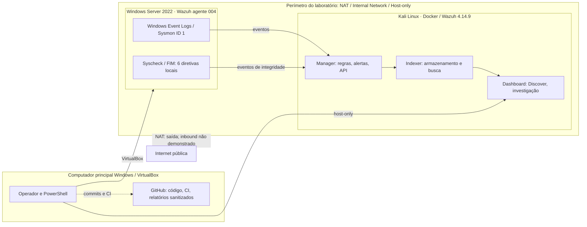

# Arquitetura e exposição pública — laboratório SOC / Detection Engineering

**Verificação:** 04/11/2026 (BRT). **Escopo:** VM Kali Linux + Windows Server 2022 em VirtualBox, repositório de laboratório `threat-hunting-detection-lab`.

## Resposta à pergunta: este Wazuh está público?

**Não há interface em modo bridge nem IP público diretamente atribuído às duas VMs conforme a configuração VirtualBox lida nesta data.** O Kali e o Windows Server têm, cada um, três adaptadores: **NAT**, **Internal Network** e **Host-only** (ordem do Windows: internal, NAT, host-only). Os serviços Wazuh são acessados pelo host usando um **IP privado host-only**; não há necessidade de publicar esses endereços no portfólio.

**Limite da conclusão:** rede VirtualBox privada **não é teste externo de acessibilidade**. A investigação não validou exaustivamente redirecionamentos de porta no roteador/host, UPnP, DNS externo, reverse proxy, VPN/túnel ou NAT port forwarding. Sem comprovação independente desse perímetro, reportar `PUBLIC_EXPOSURE=NOT_DEMONSTRATED`, e não `NO_PUBLIC_EXPOSURE_PROVEN`.

- NAT: fornece **saída** para a internet; entrada da internet precisa de port forwarding ou outro mecanismo explícito.
- Internal Network: liga VMs participantes da rede virtual e não é uma interface pública.
- Host-only: permite ao computador Windows conversar com as VMs em rede privada.
- O dashboard, API e Indexer responderam em verificações locais anteriores às portas esperadas (redirecionamento HTTP ou autenticação exigida), o que demonstra **acessibilidade local**, não exposição pública.
- **Recomendação:** não abrir Wazuh Manager, Indexer ou API diretamente na internet; caso seja necessário acesso remoto, priorizar VPN com autenticação, ACL restrita e logs de acesso.

## Diagrama verificável

**Não confundir o fluxo com evidência H03:** o Windows `004` tem um diretório realtime na pasta de inicialização (inadequado para executáveis de teste), cinco diretivas periódicas de 12 horas e uma diretiva central UnixStyle. O diretório isolado de H03 **ainda não foi implantado**; o par FIM + Sysmon de arquivo executável não está comprovado.

## Fluxo funcional detalhado

| Camada | Implementação atual | Competência demonstrada |
| --- | --- | --- |
| Endpoint | Windows Server, Sysmon, Windows Event Channels e Wazuh Agent 004 | Telemetria, coleta, processo, FIM, hardening |
| Coleta | Manager recebe os eventos do agente e processa regras Wazuh | Normalização, parsing, detecção e severidade |
| Indexação | Indexer recebe os alertas produzidos | Pesquisa, retenção, ingestão e integridade de dados |
| Investigação | Dashboard/Discover consulta eventos indexados | Hunting, filtros por ID/agente/artefato, triagem |
| Engenharia de detecção | Regras locais, testes sintéticos, analisador offline | Detection as Code, TTPs, falsos positivos |
| Governança | Change controls A/B/C, backup DPAPI, rollback, issues e CI GitHub | Reprodutibilidade, evidência e limites operacionais |

## Como confirmar a não exposição externa com evidência

1. Em VirtualBox, registrar o tipo de cada adaptador e conferir se existem regras de **NAT port forwarding**. Não incluir IPs públicos no repositório.
2. No host, revisar mapeamentos de portas, listeners em interfaces externas, firewall, proxy reverso e serviços de túnel. Se alguma ferramenta impedir a inspeção, registrar a limitação.
3. No roteador, conferir encaminhamento de portas/UPnP e interfaces WAN, sem modificar a configuração.
4. Somente com autorização e origem externa independente, testar o DNS/IP público e portas **sem varredura intrusiva**. Evidenciar apenas estado agregado (`reachable / filtered / not-tested`), sem publicar endereços ou chaves.
5. Caso uma porta de administração esteja pública, priorizar contenção controlada e revisão de acesso; não expor um painel para demonstrar portfólio.

## Fontes e limites

- [Oracle VirtualBox — modos NAT, Internal e Host-only](https://docs.oracle.com/en/virtualization/virtualbox/7.2/user/networkingdetails.html)
- [Wazuh — FIM e diretório realtime local](https://documentation.wazuh.com/current/user-manual/capabilities/file-integrity/basic-settings.html)
- [Microsoft — Sysmon Event ID 1 (Process Create)](https://learn.microsoft.com/pt-br/sysinternals/downloads/sysmon)
- [Diagramas de gates M1](m1-scope-and-h03-diagrams-20261104.md)
- [H03 — proposta de mudança C](m1-h03-isolated-realtime-change-proposal-20261104.md)

**Estado:** `PRIVATE_VIRTUALBOX_TOPOLOGY=VERIFIED`; `PUBLIC_INBOUND=NOT_EXTERNALLY_VERIFIED`; `M1=11/17`; `H03_REAL_PAIR=INCONCLUSIVE`; `DEPLOYMENT_GATE=BLOCKED`.
