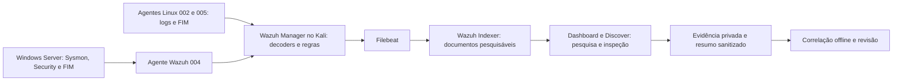

# Guia do laboratório: da estrutura à investigação

Este repositório mostra como coletar telemetria, formular uma hipótese,
testá-la com ações benignas e publicar uma conclusão sustentada por evidências.
O objetivo é aprender o processo e permitir sua revisão no GitHub.

Para saber o que está comprovado **agora**, comece pelo
[painel de progresso](roadmap-progress.md). Os checkpoints datados preservam
o histórico; uma descrição antiga não representa necessariamente o estado atual.

## 1. Arquitetura e caminho dos dados



O Kali hospeda a pilha Wazuh em contêineres; o Windows Server produz eventos
de endpoint. O escopo atual do grupo `default` é **002, 004 e 005**.
Agente ativo, configuração sincronizada, evento nativo, alerta no Manager,
documento no Indexer e resultado no Discover são verificações diferentes.

Um evento pode existir no Windows e não gerar alerta: regras e limiares
selecionam o que será armazenado em `wazuh-alerts-*`. Por isso, pesquisar
somente o Dashboard não basta para diagnosticar uma ausência.

## 2. Onde cada parte fica

| Caminho | Função e como usar |
| --- | --- |
| `README.md` | Apresentação e links de entrada |
| `ROADMAP.md` | Entregas e checklist principal |
| `docs/` | Arquitetura, decisões, hipóteses, procedimentos e checkpoints |
| `config/` | Configurações e propostas de regras; arquivo no Git não significa regra instalada |
| `detections/` | Organização das detecções Windows e Linux |
| `scripts/` | Coletores, validadores, testes controlados e correlacionador |
| `tests/` | Testes automatizados; `fixtures/` contém amostras sintéticas e código benigno |
| `cases/` | Estudos de caso do laboratório |
| `playbooks/` | Procedimentos de investigação e resposta |
| `diagrams/` | Diagramas da arquitetura e dos fluxos |
| `screenshots/` | Capturas selecionadas para publicação após revisão |
| `artifacts/` e `automation/` | Artefatos e automações auxiliares; confira o conteúdo antes de reutilizar |
| `.github/workflows/` | Validações do GitHub Actions |
| `.lab/` | Área privada ignorada pelo Git: originais, hashes, executáveis e resultados locais |

## 3. O que estamos tentando comprovar no M1

| Hipótese | Sequência esperada | Chave que precisa coincidir |
| --- | --- | --- |
| H01 | Processo PowerShell → criação real de tarefa, até 15 minutos | Mesmo ativo e ator |
| H02 | Criação de conta → logon com privilégio, até 30 minutos | Mesma conta; confirmar SID e vínculos do logon nas fontes |
| H03 | Alteração de arquivo → execução, até 20 minutos | Mesmo ativo e mesmo artefato |

Leia o [contrato completo das hipóteses](m1-three-hunting-hypotheses.md).
O motor em [`hunt_correlations.py`](../scripts/hunt_correlations.py) recebe
registros normalizados; ele não consulta VMs nem comprova sozinho que os
eventos fornecidos são reais. Um par é candidato de investigação, não
um diagnóstico de ataque.

## 4. H03 explicado com um exemplo benigno

O [código C#](../tests/fixtures/h03_benign_probe.cs) apenas imprime a versão
e retorna 0. Compilamos versões v1/v2 com hashes distintos. O caminho
positivo permanece o mesmo enquanto o conteúdo muda.

1. Conferir agente, serviço, Sysmon, NTFS, ACL, diretório isolado e FIM realtime.
2. Criar v1 e confirmar seu evento de inclusão no Manager e no Indexer.
3. Substituir v1 por v2 no mesmo caminho. Confirmar FIM `modified`, hash
   anterior v1 e hash posterior v2, antes de autorizar a execução.
4. Executar v2 uma vez. Conferir Sysmon EID1, imagem, SHA-256, RecordID e
   ProcessGuid; comparar a fonte nativa com Manager e Indexer.
5. Executar a cópia de controle em **outro caminho**. O par entre a alteração
   do primeiro objeto e a execução do segundo deve produzir **zero candidatos**.
   A ausência de alerta da cópia não é o controle: precisamos observar sua execução.
6. Conferir os eventos no Discover, rodar a correlação e remover os arquivos
   descartáveis. Validar que a configuração e o serviço continuam íntegros.

O [teste de arquivo texto](m1-h03-change-c-activated-20261110.md) comprovou
FIM/ingestão, mas não execução. Sysmon EID11 é criação de arquivo; a prova
de execução pedida pelo H03 é **EID1**.

A [regra de telemetria restrita](m1-h03-process-telemetry-proposal-20261110.md)
tem descrição de teste benigno e nível 3. Não elevamos todos os processos
nem rotulamos o probe como malware para obter um alerta.

## 5. Reproduzir sem confundir os ambientes

Os comandos abaixo são verificações **offline no checkout local**:

```powershell
python -m pytest -q
python scripts/roadmap_progress.py
python scripts/hunt_correlations.py --fixture --input tests/fixtures/m1-synthetic.jsonl
```

O último comando usa dados sintéticos e não comprova nenhum evento real.
Para uma coleta real, preserve os originais em `.lab/`, confirme as identidades
e só então normalize os sete campos exigidos pelo correlacionador.

Os executores de VM ficam em [`scripts/windows/`](../scripts/windows/). O
[`TESTAR_H03.cmd`](../scripts/windows/TESTAR_H03.cmd)
depende de um manifesto privado e de uma sessão autorizada; ele não é um
instalador genérico. O [executor Windows](../scripts/M1_H03_CONTROLLED_BINARY_TEST.ps1)
recusa outro agente, espera recibos de ingestão e limita a execução a dois
probes. Mantém os originais nativos na VM; usa propriedades transitórias do
VirtualBox para comunicar referências ao host sem liberar escrita na pasta
compartilhada. O [auditor de Manager/Indexer](../scripts/m1_h03_live_manager_indexer_audit.py)
é somente leitura e não substitui a inspeção no Discover.

## 6. Publicar no GitHub

```powershell
git status --short
git diff --check
git diff
# Adicione explicitamente apenas os arquivos públicos revisados.
git add -- docs/arquivo-revisado.md
git commit -m "docs: registrar resultado e limites da validação"
git push origin NOME_DO_BRANCH_REVISADO
```

Revise o diff antes do commit. Não inclua `.lab/`, executáveis, chaves,
credenciais, logs originais ou identidades privadas. `.gitignore` ajuda,
mas não remove um segredo já versionado. Preserve a conclusão, o procedimento,
as contagens e as limitações; mantenha a prova bruta no ambiente privado.

No pull request, explique o problema, o comportamento final e a validação.
CI aprovado significa que os testes passaram; não substitui telemetria real,
revisão humana nem aprovação operacional.

## 7. Quando encerrar e partir para o próximo projeto

Feche cada hipótese com fontes e identidades verificadas, resultado positivo,
controle negativo, limpeza e limites documentados. Depois reconcilie o
checklist e faça a revisão final exigida pelo roadmap. O marco M1 completo
depende das três hipóteses e dessa revisão; concluir H03 isoladamente não
conclui H01/H02.

Para apresentar o projeto, siga: arquitetura → hipótese → ação benigna →
evento nativo → Manager/Indexer/Discover → correlação → controle negativo →
limpeza → conclusão. Essa sequência torna o laboratório útil tanto para
estudo quanto para uma demonstração técnica reproduzível.
