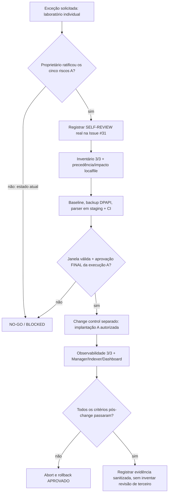

# M1 — exceção de autoavaliação do proprietário para a mudança A (FIM Linux)

**Criado em:** 04/11/2026, BRT. **Registro GitHub:** [Issue #31 — exceção da mudança A](https://github.com/raphaelguterres/threat-hunting-detection-lab/issues/31).

**Escopo:** `M1-FIM-OS-SCOPE`, proposta de adicionar apenas `os="^Linux"` à tag inicial do **único** bloco `agent_config` em `/var/ossec/etc/shared/default/agent.conf`. Aplica-se à distribuição de todo esse bloco (FIM Unix realtime **e** `localfile` Unix), com escopo previsto para `002` e `005` Linux; o agente `004` Windows não deve mais receber esse bloco. Nenhuma outra mudança operacional está incluída.

**Estado de governança:** `SOLO_OWNER_WAIVER_A=REQUESTED_NOT_RATIFIED`; `OWNER_WINDOW_APPROVAL=CONDITIONAL`; `RISK_ACCEPTANCE_A=PENDING_EXPLICIT_CONFIRMATION`; `INDEPENDENT_REVIEW_PERFORMED=false`; `CHANGE_A_EXECUTION=NO_GO`; `DEPLOYMENT_GATE=BLOCKED`.

## Justificativa e limite da exceção

O projeto é um **laboratório pessoal autoral**, com um único responsável. O proprietário respondeu expressamente **“sim”** ao pedido para **preparar** uma exceção própria para a mudança A em 04/11/2026. Essa resposta autoriza preparar este instrumento e registrar a solicitação, **não comprova aceitação detalhada dos riscos nem autorização de deploy**.

A exceção proposta substitui **somente o requisito organizacional de uma segunda pessoa** por autoavaliação rastreável e controles compensatórios, **após ratificação específica**. Ela **não** deve marcar review de terceiro, assinatura independente, `HUMAN_REVIEW_VERIFIED=true` ou `MANUAL_INDEPENDENT_APPROVAL_REQUIRED=false` no validador atual. A definição e eventual adaptação do gate global exigem decisão e implementação separadas, sem reduzir os demais critérios técnicos.

A autorização/risco ratificados para a **mudança C** na [Issue #29](https://github.com/raphaelguterres/threat-hunting-detection-lab/issues/29) são independentes; **não se transferem** para esta mudança A.

## Cinco riscos residuais — ratificação obrigatória

1. **Revisão concentrada em uma pessoa.** Sem segundo revisor, um erro de diff, escopo ou interpretação pode não ser identificado.
2. **Impacto do filtro no bloco inteiro.** A regex `^Linux`, se aplicada de forma incorreta, pode retirar FIM ou a fonte `localfile` Unix de agentes Linux, manter diretivas Linux no Windows ou afetar sua configuração efetiva por precedência.
3. **Risco de distribuição, disponibilidade e ingestão.** O carregamento da configuração pode afetar sync de `002/004/005`, emissão de eventos, integridade de logs, desempenho e observabilidade Manager → Indexer → Dashboard.
4. **Rollback incompleto ou indisponível.** Dependência do backup DPAPI associado ao perfil Windows, permissões/owner `999:999`, modo `0660`, condições concorrentes ou janela insuficiente para restaurar o estado anterior.
5. **Falso sucesso na validação.** A regex testada contra metadados, o parser, os testes sintéticos e o CI **não demonstram** sozinhos o comportamento de distribuição e a cobertura FIM efetiva no endpoint.

**Declaração proposta, a confirmar expressamente pelo proprietário:**

> Como proprietário e único mantenedor do laboratório SOC, aceito expressamente os cinco riscos residuais documentados na Issue #31 e autorizo uma exceção de autoavaliação **somente para a mudança A (M1-FIM-OS-SCOPE)**. Reconheço que nenhuma revisão independente ocorreu. Reconheço que a alteração `os="^Linux"` afeta o bloco central completo, incluindo FIM e a fonte `localfile` Unix. Mantenho as verificações técnicas, os testes, a evidência, o backup, o rollback e a autorização operacional final como controles separados. Esta ratificação **não autoriza implantação automática**, não aprova a mudança C/H03 nem a auditoria Windows `4698`.

**Ratificação atual:** **PENDENTE** — somente registrar como aprovada após comentário explícito do proprietário na [Issue #31](https://github.com/raphaelguterres/threat-hunting-detection-lab/issues/31), ou consentimento inequívoco nesta conversa que seja fielmente registrado na Issue.

## Controles compensatórios obrigatórios

| Gate | Controle exigido | Evidência conhecida | Situação |
| --- | --- | --- | --- |
| A-W01 | Propriedade e escopo 3/3 | Agentes `002/004/005` consultados no Manager, `Active/synchronized` e somente `default` | PASS técnico; **atestado humano ainda pendente** |
| A-W02 | Diff mínimo e impacto do bloco | Candidata privada com única alteração `os="^Linux"`; `localfile` Unix e FIM preservados | PASS offline; **aceitação do impacto ainda pendente** |
| A-W03 | Precedência e cobertura real por SO | Somente grupo `default`; FIM local Windows inventariado; Linux local não totalmente verificado | **Pendente de verificação completa** |
| A-W04 | Segurança da candidata | Dez testes offline positivos e negativos; fonte 221 B e candidata 233 B com diff reversível | PASS offline; **parser oficial da candidata pendente** |
| A-W05 | Backup e restauração | Backup DPAPI real e hash/UID/GID/modo confrontados; ensaio isolado PASS | PASS observado; **revalidar na janela** |
| A-W06 | Testes e CI do commit de execução | Suite local 220 passed, 4 skipped, 160 subtests no preparo; CI do commit específico precisa ser confirmado | **Revalidar na janela** |
| A-W07 | Janela válida | 05/11/2026 18h–19h BRT, aprovada **condicionalmente** pelo proprietário ([Issue #17](https://github.com/raphaelguterres/threat-hunting-detection-lab/issues/17#issuecomment-6646704047)) | Janela autorizada; **não é GO** |
| A-W08 | Ratificação dos riscos e autoavaliação | Este documento e Issue #31 | **PENDENTE** |
| A-W09 | GO operacional explícito | Decisão separada, após revisar A-W01 a A-W08; executor e rollback identificados | **PENDENTE** |
| A-W10 | Pós-mudança e abort/rollback | 3/3 sync, Linux FIM presente, Windows sem diretiva Unix; Manager, Indexer e Dashboard verificáveis | **Não executado** |

O `verify-agent-conf` no **arquivo ativo original** já retornou `OK`. A tentativa de validação da candidata por `/dev/stdin` falhou por limitação de entrada **sem determinar se o XML é aceito**; o candidato deverá ser validado em arquivo temporário real e não ativo, autorizado, e removido depois, preservando evidências privadas.

## Fluxo de decisão

**Proibições explícitas:** não aprovar review inexistente, não editar manifesto com `verified` por suposição, não alterar o `default/agent.conf` ativo durante a preparação, não reiniciar containers/VMs por rotina e não executar o binário H03 por força desta exceção.

**Decisão neste checkpoint:** `OWNER_WAIVER_A=PREPARED` · `RISK_ACCEPTANCE_A=PENDING` · `INDEPENDENT_REVIEW=false` · `WINDOW_CONDITIONAL=2026-11-05_18_19_BRT` · `DEPLOYMENT_GATE=BLOCKED`.

Referências: [Plano de staging e ações manuais](m1-change-a-staging-and-manual-gates-20261104.md), [pacote de aprovação FIM Linux](m1-fim-change-approval-package.md), [inventário 3/3 e rollback](m1-fim-three-agent-prechange-approval-proposal-20261104.md), [gate atual](m1-evidence-gate.md), [Issue #31](https://github.com/raphaelguterres/threat-hunting-detection-lab/issues/31).
