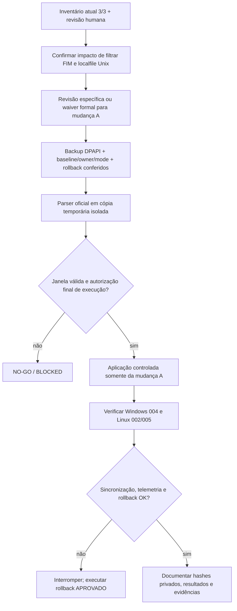

# M1 / Mudança A — staging seguro e ações manuais restantes

**Data:** 04/11/2026, aproximadamente 22h14–22h17 BRT. **Change ID:** `M1-FIM-OS-SCOPE`. **Escopo:** `default/agent.conf` do Wazuh Manager 4.14.9. **Status:** `STAGED_OFFLINE`, `DEPLOYMENT_GATE=BLOCKED`. **Não houve alteração da configuração ativa, restart, deployment nem novo alerta.**

## O que foi feito remotamente

O arquivo **real** `/var/ossec/etc/shared/default/agent.conf` foi lido **somente leitura** pelo canal SSH/CLI autorizado, como base64, decodificado no host e salvo **exclusivamente** em `.lab/m1-change-prep/` (fora do Git). Antes e depois, seu SHA-256 foi comparado com o Manager e com o backup DPAPI real registrado anteriormente. O hash ficou **inalterado**.

A ferramenta nova [`scripts/m1_stage_linux_os_scope_readonly.py`](../scripts/m1_stage_linux_os_scope_readonly.py) gerou uma **cópia privada** da configuração proposta. O código não contém funções de escrita na VM, publicação central, reinício de serviços ou alteração de agentes.

| Controle | Resultado |
| --- | --- |
| Arquivo original real | **221 bytes**, hash igual ao backup e ao Manager |
| Staging privado | **233 bytes** |
| Único diff admissível | Adicionar `os="^Linux"` à abertura de `<agent_config>` |
| Diretiva Linux FIM realtime | **Preservada: 1** |
| Fonte de logs Unix `localfile` | **Preservada: 1** |
| Blocos `agent_config` Linux | **1**, sem diretiva Windows adicionada |
| Comparação byte a byte reversa | **PASS** — remover o atributo proposto recupera todos os bytes originais |
| SHA-256 no Manager após staging | **Sem alteração** |
| Testes da ferramenta | **10 PASS**, incluindo casos negativos e recusa de overwrite |
| Wazuh parser oficial na candidata | **PENDENTE** — o método sem arquivo em `/dev/stdin` foi recusado |
| Seleção real `^Linux` distribuída aos agentes | **Não testada** |
| Implantação | **NÃO EXECUTADA** |

**Limite importante:** foi feita uma tentativa read-only de passar a candidata ao `verify-agent-conf -f /dev/stdin`; a ferramenta recusou a entrada como arquivo inválido. **Isso não é validação de parser e não deve ser classificado como sucesso ou falha da sintaxe da candidata.** A documentação oficial do Wazuh orienta usar um arquivo temporário real, validá-lo com `verify-agent-conf -f <caminho>` e só depois promover a versão aprovada. [Fonte oficial](https://documentation.wazuh.com/current/user-manual/reference/centralized-configuration.html).

## Validações que agora podem ser consideradas concluídas tecnicamente

1. **Inventário:** Manager confirmou `002/004/005` ativos e sincronizados, pertencendo apenas ao grupo `default`, dois Linux e um Windows.
2. **Precedência de grupos:** não há grupo concorrente entre esses três agentes; ainda falta analisar FIM local do Linux `002/005` para declarar a cobertura efetiva completa.
3. **Baseline/backup:** hash, tamanho, UID/GID e modo do arquivo central atual foram confrontados com o backup DPAPI; recuperação isolada da cópia original e controle negativo de corrupção passaram.
4. **Impacto declarado:** adicionar o atributo ao bloco central **restringirá tanto FIM Linux como a fonte de logs Unix `localfile`**, que continuará no arquivo mas deixará de ser oferecida ao Windows. A escolha precisa de aceite humano como parte da mudança A.
5. **Teste negativo de escopo:** a expressão `^Linux` corresponde aos metadados observados de `002/005`, não aos de `004`. Isso não é prova de seleção real pós-distribuição.

**Nova governança:** [Issue #31](https://github.com/raphaelguterres/threat-hunting-detection-lab/issues/31) e [exceção individual proposta especificamente para A](m1-change-a-solo-owner-review-exception-20261104.md). O proprietário autorizou **preparar** a exceção, mas ainda falta aceitar expressamente os cinco riscos, atestar inventário/impacto e dar autorização final; nenhuma revisão de terceiro foi registrada.

## O que falta fazer manualmente

| Ação | Responsável | Evidência exigida | Status |
| --- | --- | --- | --- |
| **A-01 — Atestar inventário 3/3** | Proprietário/revisor | Conferir os registros privados e registrar decisão na Issue #17 | **Pendente** |
| **A-02 — Aceitar impacto do bloco inteiro** | Proprietário/revisor | Reconhecer que FIM realtime e fonte `localfile` Unix passarão a ser exclusivos dos agentes Linux | **Pendente** |
| **A-03 — Revisão da mudança A** | Revisor independente ou exceção **específica** formalizada para A pelo proprietário | Revisão do diff, riscos e controles; **a exceção da mudança C não é transferível** | **Pendente** |
| **A-04 — Parser oficial em staging temporário** | Operador autorizado | Validação da cópia candidata real com `verify-agent-conf -f` num **arquivo temporário que não seja a configuração ativa**, seguida de remoção/checagem | **Pendente de autorização para staging na VM** |
| **A-05 — Pré-check em janela** | Operador | Revalidar 3/3, backup DPAPI, sha256/UID/GID/mode, logs, rollback, parser e tempo disponível para revert | **Pendente da janela** |
| **A-06 — Autorização operacional final** | Proprietário | Aprovar **execução** de mudança A com referência rastreável, não apenas agendar a janela | **Pendente** |
| **A-07 — Validação pós-mudança** | Operador | Configuração aplicada em `002/005`, ausência do bloco no Windows `004`, sincronização e cadeia Manager → Indexer → Dashboard | **Pendente de deployment** |

**Janela do proprietário:** **05/11/2026, 18h00–19h00 BRT** — aprovada **condicionalmente** na [Issue #17](https://github.com/raphaelguterres/threat-hunting-detection-lab/issues/17#issuecomment-6646704047). A janela não concede GO, não inicia operação automaticamente e termina às 19h.

### Roteiro de conferência pré-cutover — não executável automaticamente

## Integridade do processo

O validador `m1_evidence_gate.py` continua exibindo `EVIDENCE_SOURCE=PRIVATE_UNATTESTED`, `EVIDENCE_COMPLETENESS=INCOMPLETE` e `DEPLOYMENT_GATE=BLOCKED`. **Não alterar checks para `verified` só porque scripts passaram**. A aprovação de janela, a validação local e a revisão independente são objetos distintos.

Nenhum arquivo em `.lab/` deve ser publicado; o relatório versionado contém somente contagens e estados. Mudança C/H03 e Windows `4698` estão explicitamente fora deste escopo.

**Lembrete agendado:** 05/11 às 17h45 BRT para pré-checks. **Próximo progresso seguro:** documentação revisada, CI atualizado e, se houver aprovação específica, validação de parser em staging temporário seguida de consulta pós-validação.
