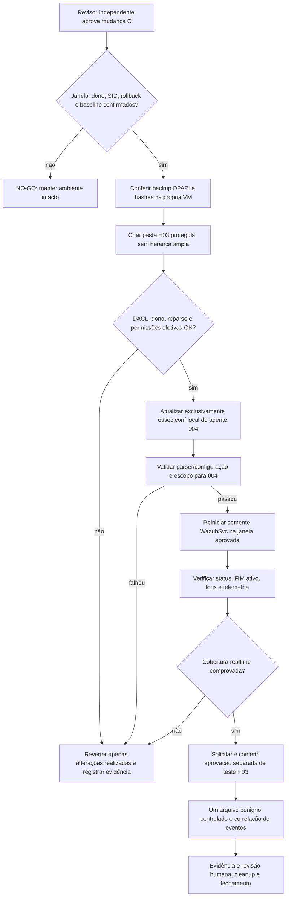

# M1 — Change C / H03: pacote de aprovação e execução controlada

**Preparado em 04/11/2026, BRT.** **Estado: PREPARED / NOT APPROVED / DEPLOYMENT_GATE=BLOCKED.**

Este documento registra evidências reais coletadas em somente leitura e um backup protegido do `ossec.conf` local do agente Windows `004`. **Não autoriza execução de alteração do FIM, teste de binário, ACL real, reinício nem merge.**

## Progresso verificado — sem pendências repetidas

| Gate | Evidência real | Decisão |
| --- | --- | --- |
| Operador técnico identificado | VM `004`: sessão elevada `Administrator` (conta local RID 500); SID completo capturado apenas em `.lab/` | **Identidade verificada**; titular e autorização de negócio ainda requerem validação do dono |
| Agente e serviço | `WazuhSvc=Running`, serviço `LocalSystem`; Wazuh Manager confirmou sincronização `004` e parser `agent.conf` OK | **PASS** de estado, não de configuração ativa |
| FIM local e central | 6 diretivas locais, 1 central UnixStyle; nenhuma colisão exata de caminho, central sem `os`, H03 não monitorado | **Inventário confirmado**; API de configuração efetiva ainda pendente |
| ACL isolada | Simulação `DirectorySecurity` protegida de herança: `SYSTEM`, `Administrators`, operador sintético; sem ACEs amplas; `Everyone` foi rejeitado com exit 2 | **PASS em memória**; SID do operador deve ser verificado na VM antes de aplicar |
| Backup real do `ossec.conf` | Criptografado no Windows Server via DPAPI `CurrentUser` em pasta própria de DACL restrita. Fonte 9725 B; backup cifrado 9942 B | **BACKUP CRIADO** |
| Restauro isolado | Criptografia/decriptografia, SHA-256 de bytes iguais; corrupção negativa rejeitada. Uma segunda leitura do backup retornou `BACKUP_MATCHES_CURRENT_ACTIVE_FILE=True` | **PASS** de recuperação **em memória**; restauração operacional não executada |
| Revisão independente | GitHub PRs #24 e #25 sem review formal registrado na consulta de 04/11 | **PENDENTE** — não pode ser substituída por aprovação do próprio autor, CI ou assistente |
| Janela operacional | **Proposta:** 04/11/2026, **18:00–19:00 BRT**, a confirmar explicitamente com o operador e o revisor | **NÃO APROVADA**; não iniciar automaticamente |
| Rollback | Backup local do arquivo afetado já íntegro; etapas de revert em execução devem ser acordadas, com serviço, checksum, alerta e log pós-mudança | **Planejado**, não executado sobre arquivo ativo |

**Evidências privadas de backup:** `.lab/m1-change-prep/M1_CHANGE_C_PRIVATE_BACKUP_RECEIPT_20261104.md`, `.lab/m1-change-c-backup-guest-result2.png` e `.lab/m1-change-c-repeat-verify.png`. O backup criptografado é **local à VM**, no perfil do operador, e **não deve ser enviado ao Git**. A chave DPAPI é vinculada ao mesmo usuário local; verificar disponibilidade desse perfil durante a janela e no rollback. Em caso de indisponibilidade, **NO-GO**.

## Etapa que ainda exige consulta ativa

A configuração no disco não equivale à configuração em execução. Após acesso autorizado ao Wazuh Dashboard: **Agents management → Summary → agente 004 → Configuration → File Integrity Monitoring**. Alternativa por API autenticada e de **somente leitura**: `GET /agents/004/config/syscheck/syscheck` com token autorizado, sem revelar token. Confirmar `disabled`, `frequency`, modo realtime, exclusões, caminhos normalizados e diferença em relação à proposta. **O comando não foi executado nesta rodada porque a interação remota com o painel foi bloqueada pela ferramenta; não contornar.**

## Plano de corte (não executar antes de GO)

### Critérios de parada e rollback

- **Abortar** se SID real não for aprovado, horário vencido, backup ou DPAPI indisponíveis, ACL ampla, parser/sync divergente, serviço indisponível, excesso de eventos, diretório com reparse point, interferência em outros agentes ou qualquer mudança além de `004`.
- Registrar **antes** o hash de baseline do `ossec.conf`, o hash atual esperado e o backup exato. Não publicar hashes, SID, hostnames nem logs brutos.
- **Rollback aprovado:** parar a execução do teste; restaurar exclusivamente o `ossec.conf` original após conferir que o hash atual pertence à própria mudança e que o backup DPAPI corresponde à baseline; validar XML e manter evidência; reiniciar exclusivamente `WazuhSvc` quando a janela e a aprovação permitirem; verificar saúde, escopo anterior e ingestão.
- Não apagar `alerts.json` ou evidências; limpar somente o diretório/artefatos pertencentes à mudança, após conferir seu conteúdo e a aprovação. Não fazer rollback automático às cegas.
- A mudança Linux `os="^Linux"` (A) e Windows Security `4698` (B) **não fazem parte da mudança C**.

## Registro da decisão humana (a completar pelo revisor/operador)

- **Responsável pela execução:** `UNCONFIRMED` (conta técnica Administrator identificada).
- **Revisor independente GitHub:** `NOT_ASSIGNED`.
- **Escopo autorizado:** `WindowsServer agent 004 ONLY`.
- **Janela sugerida:** `2026-11-04 18:00-19:00 America/Sao_Paulo`.
- **Aprovação do revisor com referência verificável:** `PENDING`.
- **Aprovação explícita do dono para criar pasta/ACL, alterar FIM e reiniciar serviço:** `PENDING`.
- **Aprovação adicional para alterar/executar binário H03:** `PENDING`.
- **Decisão formal:** `NO-GO`.

**M1 atual: 11/17 (64,7%); `DEPLOYMENT_GATE=BLOCKED`.** O backup validado reduz um risco operacional, mas não libera o cutover.

Referências: [runbook dos três gates](m1-h03-three-gates-acl-fim-sequence-20261104.md), [checkpoint ACL/FIM](m1-h03-change-c-baseline-acl-checkpoint-20261104.md), [proposta Change C](m1-h03-isolated-realtime-change-proposal-20261104.md), [Issue #9](https://github.com/raphaelguterres/threat-hunting-detection-lab/issues/9).
