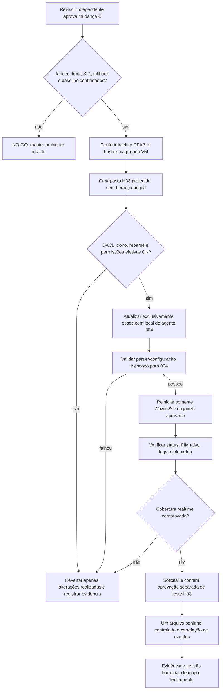

# M1 — Change C / H03: pacote de aprovação e execução controlada

**Preparado em 04/11/2026, BRT.** **Estado: OWNER_APPROVAL=GRANTED_CONDITIONAL / CHANGE_C_EXECUTION=NO_GO / DEPLOYMENT_GATE=BLOCKED.**

**Registro explícito do proprietário:** em 04/11/2026 às 17h28 BRT, o proprietário declarou na conversa que **aprova condicionalmente a janela 18h–19h BRT** e o escopo específico da mudança C, sujeito a todos os gates restantes. O ato foi registrado na [Issue #9](https://github.com/raphaelguterres/threat-hunting-detection-lab/issues/9) (comentário ID `6641318793`). Não constitui revisão independente e **não autoriza o binário H03**. Nenhuma mudança inicia automaticamente às 18h.

**Modelo individual solicitado depois:** proprietário solicitou exceção de autoavaliação. [Documento da exceção](m1-change-c-solo-owner-review-exception-20261104.md) e [Issue #29](https://github.com/raphaelguterres/threat-hunting-detection-lab/issues/29) estabelecem riscos e compensações. **Independência não realizada; aceitação específica dos riscos ainda precisa ser ratificada pelo proprietário.** A exceção é exclusiva de C e não altera o gate de M1-FIM-OS-SCOPE.

Este documento registra evidências reais coletadas em somente leitura e um backup protegido do `ossec.conf` local do agente Windows `004`. **Não autoriza execução de alteração do FIM, teste de binário, ACL real, reinício nem merge.**

## Progresso verificado — sem pendências repetidas

| Gate | Evidência real | Decisão |
| --- | --- | --- |
| Operador técnico identificado | VM `004`: sessão elevada `Administrator` (conta local RID 500); SID completo capturado apenas em `.lab/` | **Identidade verificada**; titular e autorização de negócio ainda requerem validação do dono |
| Agente e serviço | `WazuhSvc=Running`, serviço `LocalSystem`; Wazuh Manager confirmou sincronização `004` e parser `agent.conf` OK | **PASS** de estado, não de configuração ativa |
| FIM local e central | 6 diretivas locais, 1 central UnixStyle; nenhuma colisão exata de caminho, central sem `os`, H03 não monitorado | **Inventário confirmado**; API de configuração efetiva ainda pendente |
| ACL isolada | Simulação `DirectorySecurity` executada **na VM 004 com SID real da sessão `Administrator`**, obtido do próprio Windows: três ACEs específicas (`SYSTEM`, `Administrators`, operador), herança protegida e zero ACEs amplas; controle negativo `Everyone` rejeitado com exit 2 | **PASS em memória COM SID REAL**; futura ACL efetiva da pasta ainda não existe e deverá ser inspecionada após criação autorizada |
| Backup real do `ossec.conf` | Criptografado no Windows Server via DPAPI `CurrentUser` em pasta própria de DACL restrita. Fonte 9725 B; backup cifrado 9942 B | **BACKUP CRIADO** |
| Restauro isolado | Criptografia/decriptografia, SHA-256 de bytes iguais; corrupção negativa rejeitada. Uma segunda leitura do backup retornou `BACKUP_MATCHES_CURRENT_ACTIVE_FILE=True` | **PASS** de recuperação **em memória**; restauração operacional não executada |
| Revisão independente / exceção de projeto individual | GitHub PRs #24 e #25 sem review formal; proprietário solicitou [exceção somente para a mudança C](m1-change-c-solo-owner-review-exception-20261104.md) | **REVISÃO INDEPENDENTE NÃO REALIZADA**; modelo de autoavaliação preparado, com aceitação dos riscos específicos ainda pendente; CI ou assistente não são segundo revisor |
| Janela operacional | 04/11/2026, **18:00–19:00 BRT**, aprovada condicionalmente pelo **proprietário** às 17h28 | **OWNER APPROVED (CONDITIONAL)**; revisor, gates técnicos e liberação de execução permanecem pendentes; não iniciar automaticamente |
| Rollback | Backup local do arquivo afetado já íntegro; etapas de revert em execução devem ser acordadas, com serviço, checksum, alerta e log pós-mudança | **Planejado**, não executado sobre arquivo ativo |

**Evidências privadas de backup:** `.lab/m1-change-prep/M1_CHANGE_C_PRIVATE_BACKUP_RECEIPT_20261104.md`, `.lab/m1-change-c-backup-guest-result2.png` e `.lab/m1-change-c-repeat-verify.png`. O backup criptografado é **local à VM**, no perfil do operador, e **não deve ser enviado ao Git**. A chave DPAPI é vinculada ao mesmo usuário local; verificar disponibilidade desse perfil durante a janela e no rollback. Em caso de indisponibilidade, **NO-GO**.

## Etapa que ainda exige consulta ativa

A configuração no disco não equivale à configuração em execução. Após acesso autorizado ao Wazuh Dashboard: **Agents management → Summary → agente 004 → Configuration → File Integrity Monitoring**. Alternativa por API autenticada e de **somente leitura**: `GET /agents/004/config/syscheck/syscheck` com token autorizado, sem revelar token. Confirmar `disabled`, `frequency`, modo realtime, exclusões, caminhos normalizados e diferença em relação à proposta. **O comando não foi executado nesta rodada porque a interação remota com o painel foi bloqueada pela ferramenta; não contornar.**

## Plano de corte (não executar antes de GO)

### Critérios de parada e rollback

- **Abortar** se SID real não for aprovado, horário vencido, backup ou DPAPI indisponíveis, ACL ampla, parser/sync divergente, serviço indisponível, excesso de eventos, diretório com reparse point, interferência em outros agentes ou qualquer mudança além de `004`.
- Registrar **antes** o hash de baseline do `ossec.conf`, o hash atual esperado e o backup exato. Não publicar hashes, SID, hostnames nem logs brutos.
- **Rollback aprovado:** parar a execução do teste; restaurar exclusivamente o `ossec.conf` original após conferir que o hash atual pertence à própria mudança e que o backup DPAPI corresponde à baseline; validar XML e manter evidência; reiniciar exclusivamente `WazuhSvc` quando a janela e a aprovação permitirem; verificar saúde, escopo anterior e ingestão.
- Não apagar `alerts.json` ou evidências; limpar somente o diretório/artefatos pertencentes à mudança, após conferir seu conteúdo e a aprovação. Não fazer rollback automático às cegas.
- A mudança Linux `os="^Linux"` (A) e Windows Security `4698` (B) **não fazem parte da mudança C**.

## Registro da decisão humana (a completar pelo revisor/operador)

- **Conta técnica identificada no endpoint:** Windows Server `Administrator` (RID 500), SID capturado privadamente. Simulação de ACL com o **SID real da sessão** validada na VM em 04/11 às ~17h29 BRT (imagem privada `.lab/m1-owner-real-operator-acl-in-memory.png`); vínculo formal entre executor e proprietário deve ser conferido na janela.
- **Revisor independente GitHub:** `NOT_PERFORMED`. Como o projeto é individual, foi aberta uma **exceção específica para Change C** na [Issue #29](https://github.com/raphaelguterres/threat-hunting-detection-lab/issues/29), com autoavaliação e controle compensatório. **O dono ainda precisa ratificar os riscos enumerados na exceção.** O validador M1 Linux mantém sua exigência distinta.
- **Escopo aprovado pelo proprietário, condicionado aos gates:** `WindowsServer agent 004 ONLY`: diretório isolado com ACL restrita, uma diretiva FIM realtime local e restart somente de `WazuhSvc`.
- **Janela aprovada pelo proprietário:** `2026-11-04 18:00–19:00 America/Sao_Paulo`, expira ao término; **não é autorização de início automático**.
- **Evidência da autorização de proprietário:** [Issue #9](https://github.com/raphaelguterres/threat-hunting-detection-lab/issues/9), comentário ID `6641318793`, registrada em 04/11 às 17h28 BRT; `OWNER_APPROVAL=GRANTED_CONDITIONAL`.
- **Aprovação do revisor independente com referência verificável:** `PENDING`.
- **Consulta da configuração Syscheck ativa por API/Dashboard:** `PENDING` (não inferir do XML).
- **Aprovação adicional para alterar/executar binário H03:** `EXPLICITLY_NOT_GRANTED`.
- **Decisão formal de execução:** `NO-GO` / `DEPLOYMENT_GATE=BLOCKED`.

**M1 atual: 11/17 (64,7%); `DEPLOYMENT_GATE=BLOCKED`.** O backup validado reduz um risco operacional, mas não libera o cutover.

Referências: [runbook dos três gates](m1-h03-three-gates-acl-fim-sequence-20261104.md), [checkpoint ACL/FIM](m1-h03-change-c-baseline-acl-checkpoint-20261104.md), [proposta Change C](m1-h03-isolated-realtime-change-proposal-20261104.md), [Issue #9](https://github.com/raphaelguterres/threat-hunting-detection-lab/issues/9).
