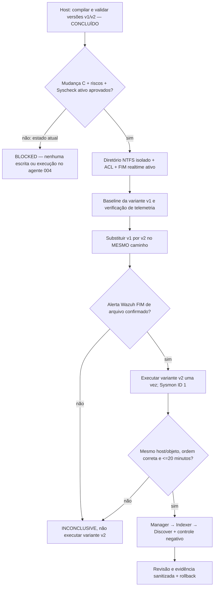

# M1/H03 — teste benigno de binário: preparação, execução controlada e evidências

**Data:** 04/11/2026. **Tipo:** experimento autorizado solicitado pelo proprietário do laboratório, ainda **não executado ponta a ponta** no agente Wazuh `004`. **Não confundir o ensaio no host com detecção na VM.**

## Situação da autorização

- Em 04/11, o proprietário aprovou condicionalmente **a mudança C** do Windows 004 para a janela 18h–19h BRT, sujeita aos demais gates.
- Depois, solicitou expressamente **o teste benigno de binário H03**. Isto constitui intenção de realizar o teste, não comprovação dos pré-requisitos técnicos nem liberação automática do gate.
- [Exceção de autoavaliação para projeto individual](m1-change-c-solo-owner-review-exception-20261104.md) registrada na [Issue #29](https://github.com/raphaelguterres/threat-hunting-detection-lab/issues/29); **aceitação dos cinco riscos ratificada pelo proprietário**. Os controles técnicos continuam obrigatórios.
- O Dashboard **General/Monitored do agente 004** foi observado: FIM habilitado, frequência 43200 s e entrada `C:\opt\wazuh-lab\monitorado` realtime. Essa entrada provém da diretiva Linux compartilhada `/opt/wazuh-lab/monitorado` no grupo `default`; **não prova pasta Windows existente ou detecção de arquivo**. [Checkpoint](m1-agent004-dashboard-active-fim-20261104.md). A aba Ignored e a cobertura real continuam pendentes; o novo diretório H03 não existe e não está coberto.
- **Não usar a pasta Startup monitorada em tempo real**: criar executável ali pode produzir inicialização automática e persistência não intencional.
- Status: `BINARY_TEST_REQUESTED=YES`, `H03_LIVE_TEST_READY=NO`, `DEPLOYMENT_GATE=BLOCKED`.

## Artefato próprio e benigno

**Código-fonte:** [`tests/fixtures/h03_benign_probe.cs`](../tests/fixtures/h03_benign_probe.cs). É um programa C# de console extremamente curto: imprime uma string de versão e retorna código 0. Não usa rede, registro, processos filhos, persistência, escrita em arquivos nem privilégio elevado.

**Construção em host Windows somente:** [`scripts/build_h03_benign_probe_host_only.ps1`](../scripts/build_h03_benign_probe_host_only.ps1). Compila duas versões com valores de texto diferentes usando o `csc.exe` do .NET Framework, preservadas em `.lab/h03-binary-artifacts/`, que é privado e não versionado. **Nenhum executável é enviado à VM por esse script.**

Comando **de ensaio offline no computador principal**, nunca na VM WindowsServer:

```powershell
powershell -NoProfile -ExecutionPolicy Bypass -File scripts/build_h03_benign_probe_host_only.ps1 -RunOnHost
```

Resultado efetivamente obtido em 04/11:
```text
H03_BUILD_MODE=HOST_ONLY_PRIVATE_STAGING
BINARIES_BUILT=2
SHA256_VERSIONS_DISTINCT=TRUE
HOST_EXECUTIONS=2
HOST_FUNCTIONAL_TEST=PASS
WINDOWS_SERVER_GUEST_EXECUTIONS=0
WAZUH_FIM_EVENTS_EXPECTED_FROM_THIS_STEP=0
H03_REAL_PAIR=NOT_TESTED
DEPLOYMENT_GATE=BLOCKED
```

Este teste confirma que duas variantes do mesmo programa **compilam, executam sem erro no host e produzem hashes diferentes**. Não mostra FIM ou Sysmon da VM e **não deve ser contado como conclusão H03**. Hashes, executáveis e caminhos completos ficam apenas em `.lab/`.

## Teste real futuro — exclusivamente após gates de mudança C

1. Validar no Dashboard/API o **Syscheck ativo** do agente `004`, fonte da regra e recorte temporal, com registro privado de baseline. Guardar evidência de que o agente está sincronizado e o `WazuhSvc` está saudável.
2. Concluir autorização formal da exceção de proprietário (riscos aceitos), confirmar janela em vigor, hashes e backup DPAPI recuperável, plano de rollback e requisitos de ACL.
3. Aplicar **mudança C isolada** na janela: criar diretório local NTFS restrito e sem autorun; confirmar DACL, dono e reparse points; adicionar **uma diretiva realtime apenas para o agente 004**; validar XML e reiniciar somente `WazuhSvc` com autorização; confirmar configuração Syscheck **efetivamente ativa**.
4. Confirmar baseline FIM completa. **Somente então** transferir variante `v1` do programa para o diretório monitorado e registrar a evidência, sem aproveitar um alerta inicial como prova de alteração do binário.
5. Substituir a variante `v1` pela `v2` **no mesmo nome de arquivo e caminho**, evitando escrita em sistema/Startup; observar FIM de arquivo com regra, agente, hash/timestamp correspondentes. Não prosseguir se a detecção ainda não tiver ocorrido.
6. Executar somente o programa benigno `v2` uma vez, conferindo que o **Sysmon Event ID 1 (ProcessCreate)** aponta para a **mesma imagem**. Event ID 11 (FileCreate) é uma fonte diferente, não substitui ID 1.
7. Correlacionar `file_change (wazuh_fim)` **antes** de `file_execution (sysmon_eid1)`, no mesmo ativo e objeto, em **até 20 minutos**. Comparar originais no Manager, Indexer e Dashboard, com timestamps normalizados para UTC; preservar referências de origem.
8. Realizar controle negativo com artefato ou ativo diferente, verificar que o correlacionador não gera par positivo indevido; documentar falsos positivos e falhas.
9. Realizar limpeza/rollback aprovada, validar retorno da configuração original e saúde do serviço, manter evidências sanitizadas no GitHub, com arquivos brutos e hashes apenas em `.lab/`.



## Critérios de aceite do caso H03

- **Não basta** ter um alert Sysmon ID 1 e outro alerta FIM qualquer: devem representar **mesmo executável, mesmo agente, ordem e janela corretas**.
- Usar `scripts/hunt_correlations.py` com eventos normalizados e referências de fonte verificáveis; rejeitar objetos diferentes, timestamps sem fuso, casos inversos e recortes incompletos.
- Registrar `PROVEN_FIM_FILE_CHANGE=true` e `PROVEN_SYSMON_EID1_EXECUTION=true` **somente** após observar ambos nas origens. Se não houver os dois, classificar `H03_REAL_PAIR=INCONCLUSIVE`.
- **Nenhuma simulação inventada, captura ilustrativa ou resultado de ensaio offline deve ser apresentado como evidência H03 real.**

## Relação com MITRE ATT&CK

H03 é uma **hipótese comportamental de laboratório** para detectar execução após alteração de um artefato. **Não atribuir automaticamente uma técnica ATT&CK, código malicioso ou incidente** apenas pela correlação; os atributos e o contexto devem justificar o mapeamento.

Referências: [contrato H03](m1-three-hunting-hypotheses.md) · [proposta de mudança C](m1-h03-isolated-realtime-change-proposal-20261104.md) · [pacote de aprovação](m1-change-c-approval-cutover-package-20261104.md) · [Microsoft Sysmon](https://learn.microsoft.com/pt-br/sysinternals/downloads/sysmon) · [Wazuh FIM realtime](https://documentation.wazuh.com/current/user-manual/capabilities/file-integrity/basic-settings.html).
