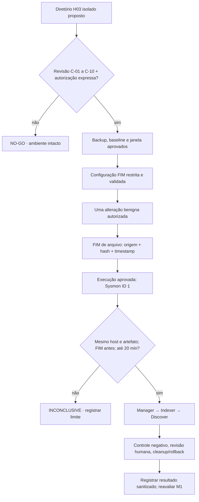

# M1 / H03 — proposta de mudança C para FIM realtime isolado

**Preparado em:** 04/11/2026. **Status:** DRAFT · NO-GO · não aprovado.  
**Ambiente:** laboratório Windows Server 2022 / agente Wazuh `004`.  
**Natureza:** desenho de mudança e critérios de aceite. **Este documento não autoriza alteração ativa nem geração de eventos.**

## Motivação e evidência existente

H03 busca uma alteração FIM de **arquivo** seguida da execução do **mesmo artefato**, no mesmo ativo, em ordem cronológica e no máximo **20 minutos** depois. O alerta FIM deve ser confrontado com Sysmon Event ID 1 e com as fontes originais, não apenas contagens.

Leituras no Windows `004` e no Manager confirmaram:

| Dimensão | Evidência | Limite |
| --- | --- | --- |
| Agente | Wazuh 4.14.9, Windows Server 2022, ativo e sincronizado; Syscheck com varredura registrada | Não comprova H03 |
| FIM local | 6 diretivas: 5 periódicas (12 h), 1 realtime | Existência de diretivas não prova cobertura do artefato |
| Única pasta realtime | Startup do Menu Iniciar de todos os usuários | **NO-GO** para executável: risco de inicialização automática |
| Outros 5 caminhos | Áreas de sistema Windows | Não usar como destino de artefato de teste |
| Configuração central | Diretiva UnixStyle do grupo `default` sincronizada, sem utilidade na VM Windows | Corrigir apenas em change request separado (A) |
| Canal Sysmon | `Microsoft-Windows-Sysmon/Operational` habilitado | Não prova que um executável específico será registrado |
| Manager ativo | Histórico recente de Sysmon ID 1; ausência de FIM de arquivo no `alerts.json` ativo observado | Janela e origem limitadas, não descarta eventos rotacionados |
| H03 | Sem par real FIM arquivo + Sysmon 1 | `INCONCLUSIVE` |

O bloqueio de pasta Startup está registrado em [m1-h03-startup-realtime-no-go-20261104.md](m1-h03-startup-realtime-no-go-20261104.md). Um filtro preventivo, **somente offline**, existe em [scripts/m1_h03_candidate_safety_gate.py](../scripts/m1_h03_candidate_safety_gate.py); mesmo um resultado `REVIEW_REQUIRED` não equivale a cobertura real nem aprovação.

## Mudança C proposta — ambiente de teste segregado

Considerar **somente após revisão** um diretório NTFS independente, por exemplo `C:\SecurityLab\H03\`, sem ligação com Startup, pastas do sistema, tarefas, logon, serviços ou autorun. O caminho é **hipotético**: não assumir que existe, foi criado, está monitorado ou foi aprovado.

Em uma janela futura autorizada, a solução candidata seria configurar uma **única diretiva FIM realtime** para esse diretório, de escopo restrito ao Windows `004`, com validação dos atributos, precedência local/central, impacto de recursos, exclusões e integridade de configuração. A mudança não deve ampliar inadvertidamente a cobertura dos demais agentes do grupo `default`.

**Não executar agora**: `New-Item`, `Copy-Item`, `Set-Content`, execução de `.exe`, alteração de `ossec.conf`/`agent.conf`, `auditpol`, reinício de agentes/contêineres, varredura forçada ou correções automáticas.

## Artefato e procedimento futuro, condicionado à aprovação

Um executável inofensivo, descartável e controlado precisará ser designado e verificado pelo operador/revisor, sem tráfego de rede, persistência, privilégios elevados, escrita em locais críticos ou execução automática. Registrar privadamente proveniência, hashes de baseline e versão alterada, comportamento previsto, local de implantação e plano de limpeza. **Não usar um executável do Windows ou de terceiros como amostra modificável.**

Somente após a aprovação, o teste deve produzir **um** evento de mudança de arquivo coberto pelo FIM, seguido de **uma** execução benigna do mesmo binário verificada em Sysmon ID 1. Conferir os caminhos canônicos e hashes com os originais e normalizar timestamps para UTC. O correlacionador offline deve rejeitar arquivo distinto, host divergente, ordem invertida, janela acima de 20 minutos e ausência de referência de origem. Um candidato de hunting **não é incidente confirmado**.

## Gates obrigatórios da mudança C

| Gate | Evidência necessária | Estado |
| --- | --- | --- |
| C-01 | Dono da mudança e revisor independente nomeados | PENDENTE |
| C-02 | Diretório segregado inspecionado: NTFS, sem autorun, sem reparse/symlink inesperado | PENDENTE |
| C-03 | ACLs, capacidade, impacto de recursos e risco de detecção avaliados | PENDENTE |
| C-04 | Baseline de configuração local e central, exclusões, precedência, horários e hashes privados | PENDENTE |
| C-05 | Backup protegido, íntegro e ensaio de restauração isolada da configuração efetivamente afetada | PENDENTE |
| C-06 | Rollback específico e limpeza do artefato aprovados, sem rollback global improvisado | PENDENTE |
| C-07 | Janela de mudança, critérios de parada, disponibilidade do operador e comunicação | PENDENTE |
| C-08 | Aprovação expressa de **mudança C** e, separadamente, da **alteração/execução do binário benigno** | **NÃO APROVADO** |
| C-09 | Fontes Sysmon/FIM, Manager → Indexer → Discover, retenção e relógios reconciliados | PARCIAL |
| C-10 | Revisão da proposta/código e documentação sem evidência bruta publicada | PENDENTE |

A mudança C é **independente** da mudança A (seletor Linux `os="^Linux"`) e da mudança B (Security `4698`). Nenhuma aprovação é transferível entre elas. A autorização operacional exige que os gates aplicáveis sejam comprovados no instante do cutover, não apenas em capturas antigas.

## Fluxo de decisão

## Gatilhos de parada

- Autostart, escrita em pasta crítica ou comportamento não previsto;
- alteração fora do escopo do agente `004`, divergência de baseline ou erro de parser/sync;
- carga, retenção ou alertas inesperados;
- impossibilidade de reverter, ausência de evidência original ou janela encerrada;
- incompatibilidade de caminho/hash, horário ou identidade do evento;
- revogação ou insuficiência da aprovação.

**Não usar simulação sintética para preencher evidência operacional faltante.** Se alguma condição falhar, classificar `NO-GO` ou `INCONCLUSIVE`, sem executar novas ações automaticamente.

## Estado do projeto neste checkpoint

`ISOLATED_ROOT=PROPOSED_NOT_CREATED`  
`H03_ARTIFACT=NOT_SELECTED`  
`CHANGE_C=NOT_APPROVED`  
`H03_REAL_PAIR=INCONCLUSIVE`  
`EVIDENCE_COMPLETENESS=INCOMPLETE`  
`DEPLOYMENT_GATE=BLOCKED`

O checklist M1 permanece **11/17 (64,7%)**; proposta e testes sintéticos não encerram o milestone.

Referências: [H03 — pré-gate](m1-h03-artifact-coverage-preflight-20261104.md), [diagramas do M1](m1-scope-and-h03-diagrams-20261104.md), [agente 004 — reconciliação FIM](m1-agent004-effective-fim-reconciliation-20261104.md), [H03 — auditoria sanitizada](m1-h03-readonly-active-alerts-audit-20261104.md) e [Issue #9](https://github.com/raphaelguterres/threat-hunting-detection-lab/issues/9).
