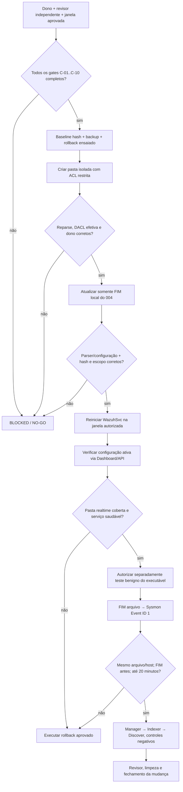

# M1/H03 — gates 1, 2 e 3: ACL, escopo efetivo e ordem de implantação

**Checkpoint:** 04/11/2026. **Estado:** `DRAFT / NO-GO`. Preparação técnica e testes somente em memória. **A configuração ativa do Windows Server/Wazuh não foi alterada; nenhum diretório foi criado e nenhum serviço reiniciado.** Mudança C exige revisão independente e uma janela previamente aprovada.

## Sumário executivo

| Frente | Verificação executada | Status |
| --- | --- | --- |
| 1. ACL restrita | Política NTFS simulada **em memória**: herança desabilitada; `SYSTEM` e `Administrators` com FullControl; operador opcional com Modify. Zero ACEs amplas de escrita | **TEMPLATE PASS**; SID verdadeiro do operador e ACL efetiva do futuro diretório pendentes |
| 2. Escopo local vs central | Leitura dentro do agente `004`: 6 diretivas FIM locais, 1 central, **0 colisões exatas de caminho**, 1 caminho UnixStyle na central, 0 central Windows e 0 seletores `os` | **PRECEDÊNCIA DOCUMENTADA**; configuração ativa via Wazuh Dashboard/API não consultada |
| 3. Ordem segura | Definida: gate de aprovação → baseline/backup → diretório protegido → verificação ACL → alteração de config local `004` → verificação/parser → restart autorizado → validação de telemetria → teste benigno autorizado → rollback/cleanup | **ROTEIRO PRONTO**; nenhuma etapa operacional disparada |

## 1. ACL NTFS restrita

O script [`scripts/M1_H03_CHANGE_C_ACL_SIMULATE.ps1`](../scripts/M1_H03_CHANGE_C_ACL_SIMULATE.ps1) **não possui comandos de criação ou gravação**. Ele cria somente um `DirectorySecurity` em memória e verifica regras por SIDs estáveis do Windows:

- `S-1-5-18`: `SYSTEM` — FullControl, herdável aos objetos do diretório proposto;
- `S-1-5-32-544`: `BUILTIN\Administrators` — FullControl, herdável;
- `<SID_PRIVADO_OPERADOR>`: conta identificada e autorizada no **Windows Server 004** — Modify, opcional no simulador, obrigatório antes do cutover;
- Nunca liberar escrita ampla para `Everyone` (`S-1-1-0`), `Authenticated Users` (`S-1-5-11`), `BUILTIN\Users` (`S-1-5-32-545`) ou `INTERACTIVE` (`S-1-5-4`).

```powershell
# Executar SOMENTE NO HOST: simulação, sem arquivo ou pasta novos
powershell -NoProfile -File scripts/M1_H03_CHANGE_C_ACL_SIMULATE.ps1

# Não publicar SID real. Um exemplo sintético pode testar a regra:
powershell -NoProfile -File scripts/M1_H03_CHANGE_C_ACL_SIMULATE.ps1 -OperatorSid 'S-1-5-21-1000-1001-1002-1003'
```

A simulação com operador **fictício** criou três ACEs na estrutura em memória, **zero** ACEs amplas; a simulação do SID `Everyone` saiu com código **2** (falha fechada). Não confundir o SID de exemplo com a conta do operador do Windows Server.

**Atenção às ACLs atuais:** `C:\` tem permissões herdáveis de `CreateFiles` e `AppendData` para identidades amplas. A pasta `C:\SecurityLab\H03` **não existe**, então não é possível afirmar sua DACL real. No futuro, evitar janela insegura entre criação de diretório e proteção da ACL; revisar implantação segura com DACL inicial, dono e controle de acesso, checando a ACL final antes de expor arquivos de teste. Não executar `icacls`, `Set-Acl` ou `New-Item` nesta rodada.

## 2. Escopo efetivo FIM: comparação e limite

Consulta XML **somente leitura** na VM `004` retornou:

```text
LOCAL_DIRECTIVES=6
LOCAL_RESOLVED_PATHS=6
CENTRAL_DIRECTIVES=1
CENTRAL_RESOLVED_PATHS=1
LOCAL_AND_CENTRAL_EXACT_PATH_OVERLAPS=0
CENTRAL_UNIXSTYLE_PATHS=1
CENTRAL_WINDOWS_PATHS=0
CENTRAL_OS_SELECTORS_PRESENT=0
LOCAL_DISABLED_VALUES=no
LOCAL_FREQUENCY_VALUES=43200
TARGET_PRESENT=False
TARGET_ALREADY_MONITORED_IN_LOCAL=False
TARGET_ALREADY_MONITORED_IN_CENTRAL=False
MERGED_MG_PRESENT=True
ACTIVE_CONFIG_API_QUERIED=NO
READONLY=YES
```

**Regra oficial Wazuh:** `ossec.conf` é lido antes de `agent.conf`; configurações conflitantes podem ser sobrescritas, enquanto caminhos diferentes podem ser combinados. Assim, os **zero caminhos idênticos** não provam bloqueio de todas as seis entradas locais, e o bloco Linux na central continua um problema de escopo separado. O arquivo `merged.mg` estar presente não equivale à consulta da configuração **ativa**.

**Evidência que falta:** no Dashboard autenticado, acessar **Agents management → Summary → agente 004 → Configuration** e consultar a seção ativa de **File Integrity Monitoring**; ou usar a API de leitura `GET /agents/004/config/syscheck/syscheck` com credenciais autorizadas e não impressas. Guardar evidência privada com timestamps e sem dados identificáveis. **Não contornar controle de acesso ou autenticidade**, não consultar credenciais do sistema em claro.

Para mudança C, a proposta preferida é adicionar uma única diretiva `realtime="yes"` no **`ossec.conf` local do 004**, após revisão da configuração ativa, **sem alterar o `default/agent.conf` compartilhado**. A mudança A de `os="^Linux"` e a mudança B de auditoria `4698` permanecem independentes.

## 3. Sequência futura de implantação (não executada)



**Detalhe indispensável:** o diretório deve existir **antes do reinício do agente** para o realtime funcionar, conforme documentação Wazuh. O serviço Windows real identificado é `WazuhSvc`, `Running`, conta `LocalSystem`. Nenhum restart está autorizado neste momento.

### Critérios de abort e rollback

- Interromper por ACL com escrita ampla, symlink/reparse inesperado, SID não conferido, mudança atingindo outro agente, conflito de configuração, parser inválido, backup insuficiente, sobrecarga de telemetria ou falta de revisão.
- Restaurar apenas a configuração afetada com baseline atestada e plano de rollback autorizado, validar serviço e regras sem apagar logs; remover o diretório de laboratório somente após conferir que é propriedade da mudança e não contém dados alheios.
- As alterações reais de ACL, configuração, restart e binário serão auditadas como fases distintas e não começarão antes de aprovação específica.

**Status final:** `ACL_SIMULATED=PASS` · `LOCAL_CENTRAL_RECONCILED=YES` · `ACTIVE_SYSCHECK_CONFIG_ATTESTED=NO` · `FUTURE_DIR_EXISTS=NO` · `DEPLOYMENT_GATE=BLOCKED` · `M1=11/17`.

### Fontes

- [Wazuh — precedência entre configuração local e central](https://documentation.wazuh.com/current/user-manual/reference/centralized-configuration.html)
- [Wazuh — consulta da configuração ativa do agente](https://documentation.wazuh.com/current/user-manual/agent/agent-management/query-configuration.html)
- [Wazuh — diretório realtime deve existir antes do reinício](https://documentation.wazuh.com/current/user-manual/capabilities/file-integrity/basic-settings.html)
- [Microsoft — icacls e proteção de herança](https://learn.microsoft.com/pt-br/windows-server/administration/windows-commands/icacls)
- [Mudança C — proposta original](m1-h03-isolated-realtime-change-proposal-20261104.md)
