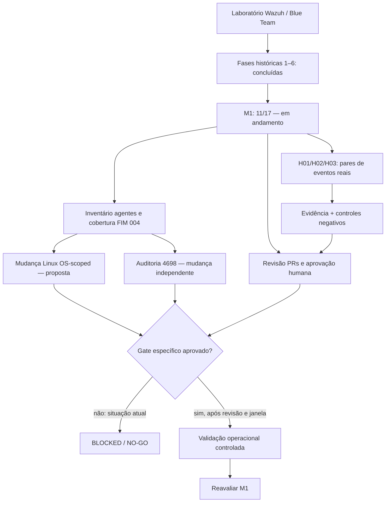
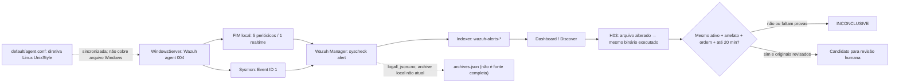
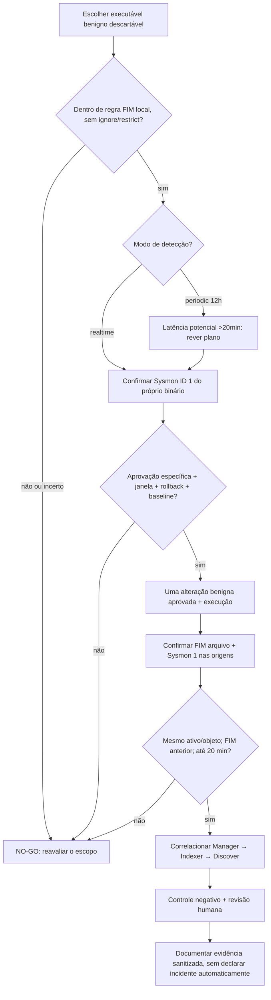

# M1 — escopos, arquitetura de evidências e fluxos H03

**Atualização:** 04/11/2026 (BRT). **Natureza:** documentação do laboratório autorizado e plano fail-closed; **não** é autorização de mudança, execução de teste ou declaração de incidente.

## 1. Situação do roadmap

- Fases históricas: **6 fases** e checklist **8/8** concluídos.
- Marco M1 (Threat Hunting): **11/17 (64,7%)** por `scripts/roadmap_progress.py`; **6 itens pendentes**.
- `DEPLOYMENT_APPROVED=false`, `HUMAN_REVIEW_VERIFIED=false`, `EVIDENCE_COMPLETENESS=INCOMPLETE`, `DEPLOYMENT_GATE=BLOCKED`.
- CI e testes sintéticos validam contratos de código; **não substituem** cobertura efetiva nem aprovação independente.

## 2. Arquitetura e limites das evidências H03

**Limites:** o agente `004` está ativo, sincronizado e com varredura Syscheck registrada em 04/11, mas não há par operacional FIM de arquivo + Sysmon 1 verificado. O bloco central Linux é inaplicável ao Windows; isso **não prova** desativação das seis entradas locais. Eventos FIM de Registro históricos **não** são evidência de alteração de arquivo.

## 3. Gate de cobertura do artefato e teste benigno

**Não executar agora:** nenhuma seleção de artefato específico, geração de arquivo, execução de amostra, força de varredura, alteração de `syscheck`, modificação de `auditpol`, reinício ou implantação está autorizada pelo progresso documental. Caminhos, hashes, usuários, eventos brutos e credenciais permanecem exclusivamente na área privada `.lab/`.

## 4. Delimitação dos change requests

| Trilha | Escopo permitido antes de aprovação | Pré-condições da mudança |
| --- | --- | --- |
| H03 | Revisão de cobertura local, exclusões, tempos e fontes, sem gerar eventos | Executável benigno e diretiva identificados; aprovação para alterar/executar; janela, rollback e validação de duas fontes |
| Linux FIM `os="^Linux"` | Proposta, parser em cópia isolada, revisão de agentes afetados | Inventário 4/4, decisão agente histórico `001`, revisão independente, backup, rollback, janela e aprovação específica |
| Windows Security `4698` | Baseline `auditpol /get`, revisão de coletores Security e retenção | Change request próprio; 20 MiB Security analisados, rollback, teste benigno e comprovação de ingestão |
| M1 PR/CI | Testes, revisão documental, CI e controle de evidências | Revisão independente e fonte real verificável; CI verde não é aprovação operacional |

## 5. Referências rastreáveis

- [Reconciliação efetiva FIM do agente 004](m1-agent004-effective-fim-reconciliation-20261104.md)
- [Pré-gate H03 de cobertura de artefato](m1-h03-artifact-coverage-preflight-20261104.md)
- [Contrato H01/H02/H03](m1-three-hunting-hypotheses.md)
- [Pacote FIM Linux](m1-fim-change-approval-package.md)
- [Change control Windows 4698](m1-change-control-4698-fim-agent004.md)
- [Painel do roadmap](roadmap-progress.md)
- Issues: [H03 #9](https://github.com/raphaelguterres/threat-hunting-detection-lab/issues/9), [4698 #15](https://github.com/raphaelguterres/threat-hunting-detection-lab/issues/15), [FIM Linux #17](https://github.com/raphaelguterres/threat-hunting-detection-lab/issues/17), [agente 001 #27](https://github.com/raphaelguterres/threat-hunting-detection-lab/issues/27).

**Resultado:** artefato H03 não selecionado, cobertura do artefato não validada, teste não executado, H03 `INCONCLUSIVE`, gate `BLOCKED`. O desenho ilustra contratos e etapas, não telemetria real validada.
